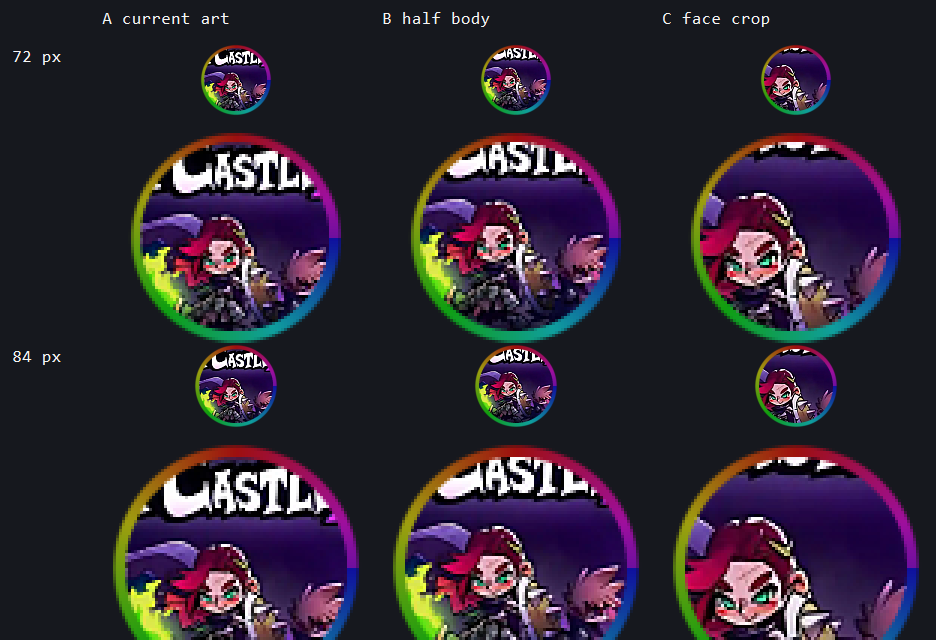
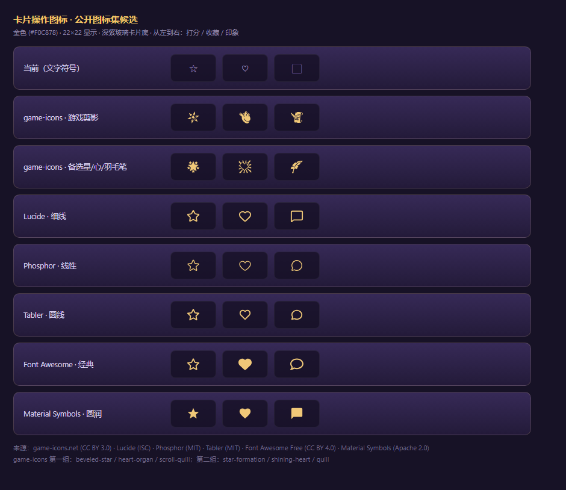
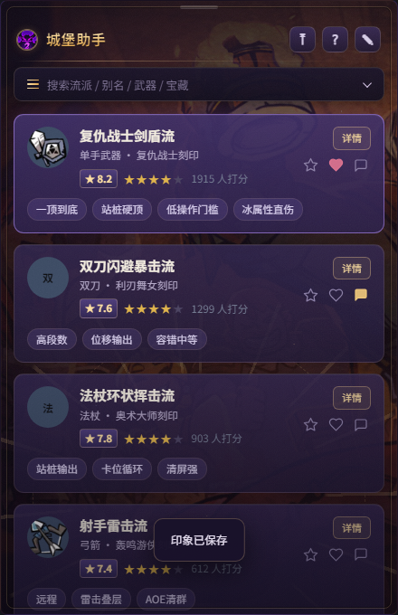

# 图标方案

## 结论：用公开素材做气泡与托盘图标

自己用代码画过一版徽章，实际效果偏"土"，最终改为**使用网络上公开的素材**：

| 用途 | 素材 | 来源 | 处理 |
|---|---|---|---|
| **气泡中心** | 剧情角色「妮娜」立绘 | [失落城堡2中文维基 · 妮娜](https://lc2.huijiwiki.com/wiki/%E5%A6%AE%E5%A8%9C)（CC BY-NC-SA 4.0） | 裁脸部特写 + 提亮/增饱和 + 金紫渐变底 + 金色外圈 |
| **托盘图标** | 官方客户端图标（紫色角盔 + "2"） | Steam 商店公开素材（© Hunter Studio） | 提亮/增饱和 + 金色外圈，保证 16/32px 可辨认 |

> 妮娜是剧情里"领主之女 / 被封印的公主"，也是封印魔神的关键角色。
> 选择她的立绘作为气泡图标，既有辨识度，也和游戏剧情直接相关。

## 文件

| 文件 | 规格 | 用途 |
|---|---|---|
| `assets/icon.png` | 256×256 | 气泡中心图形（bubble.ps1 裁圆 + 2× 超采样） |
| `assets/icon-64.png` / `icon-32.png` | 64 / 32 | 中间尺寸备用 |
| `assets/tray-32.png` / `tray-16.png` | 32 / 16 | 托盘图标（官方客户端图标提亮版） |
| `assets/source/` | — | 原始素材（妮娜立绘、封印场景、客户端图标） |
| `_icon-preview.png` | 预览 | 气泡图标 256/64/32/16 尺寸对比 |
| `_tray-preview.png` | 预览 | 托盘图标在深色任务栏上的效果 |
| `_bubble-preview.png` | 预览 | 气泡最终合成效果（彩虹光环 + 图标） |



## 生成

素材已存进仓库（`apps/desktop/assets/source/`），离线可复现：

```powershell
powershell -NoProfile -ExecutionPolicy Bypass -File scripts\make-bubble-icon.ps1
```

脚本会重新合成 `icon*.png` / `tray*.png` 与预览图。想换角色或裁剪区域，改脚本里的
`RenderBubbleMaster` / `RenderTrayMaster` 坐标即可。

## 版权说明

- 字体、角色立绘、游戏内素材版权归 **Hunter Studio** 所有；本项目为**非商业**的玩家辅助工具，仅在本地展示。
- 立绘/场景取自 [失落城堡2中文维基](https://lc2.huijiwiki.com/)（CC BY-NC-SA 4.0），已标注来源。
- 官方客户端图标来自 Steam 商店公开素材，仅作托盘识别用。
- 如需商用或再分发，请先取得版权方授权。

## 卡片操作图标（打分 / 收藏 / 印象）

卡片右侧三个操作图标使用 **Lucide** 公开图标集（ISC 许可）内联 SVG，统一 1.8 描边、
`stroke=currentColor`，选中态（已打分 / 已收藏 / 已有印象）由 CSS 填充：

- 打分：`star`
- 收藏：`heart`
- 印象：`message`（对话气泡）

> 图标集来源：https://lucide.dev （ISC License，可免费商用）。
> 选型对比见下图，备选：game-icons.net (CC BY 3.0)、Phosphor (MIT)、Tabler (MIT)、
> Font Awesome Free (CC BY 4.0)、Material Symbols (Apache 2.0)。



实际效果（第一张卡已收藏=心形填充，第二张卡已有印象=气泡填充）：


