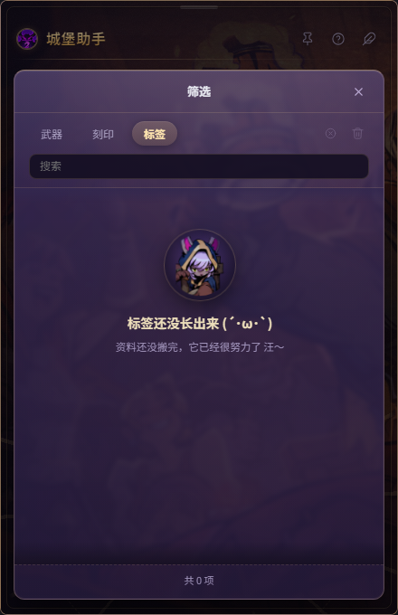
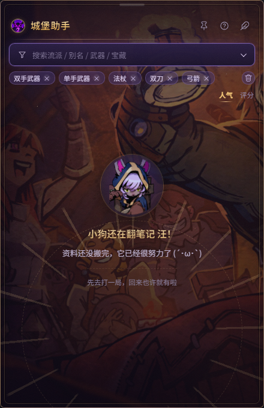
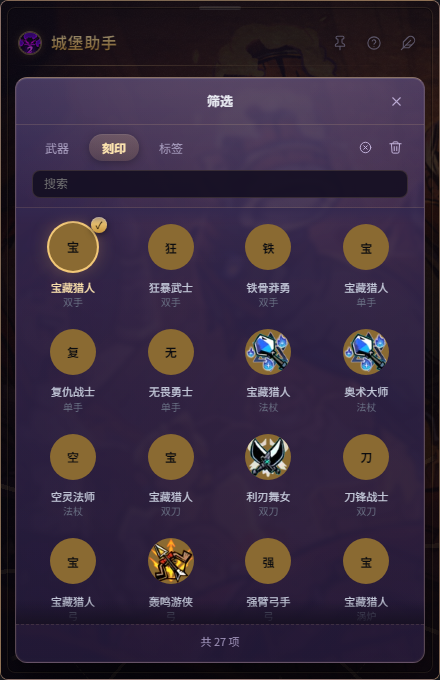
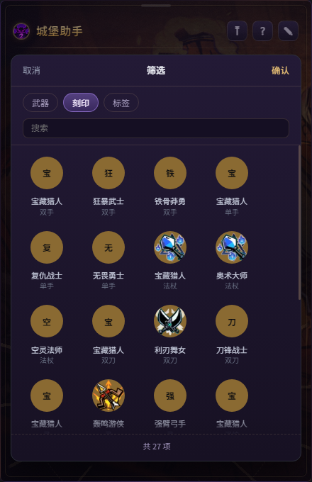

# @lc2/desktop — 客户端

Electron 桌面端的**宿主 + 渲染**。不发起请求、不做数据加工，只负责：
双窗口、全局热键、读数据源、渲染界面。

## 运行

```bash
# 在仓库根目录
npm install
npm run desktop
```

单独调试客户端：

```bash
cd apps/desktop
npm start
```

**数据源切换**（开发默认读本地 `data/`，打包后默认读 GitHub）：

```bash
LC2_DATA_SOURCE=github npm start     # 强制走 GitHub
LC2_DATA_SOURCE=local  npm start     # 强制读本地
```

## 结构

```
src/
├─ main/
│  ├─ index.js           主进程入口（组合根：启动顺序 / 依赖组装 / 退出清理）
│  ├─ panel.js           面板窗口控制器（显隐 / 拖拽 / 休眠 / 圆角 / 焦点）
│  ├─ bubble-window.js   Electron 气泡窗口（原生分层气泡的兜底）
│  ├─ config.js          用户配置（校验 / 原子写 / 防抖落盘）
│  ├─ notes-store.js     用户印象 JSON 存储
│  ├─ data.js            数据加载（包装 source 层）
│  ├─ geometry.js        窗口几何（纯函数）
│  ├─ shape.js           setShape 圆角兜底
│  ├─ tray.js            托盘
│  ├─ shortcuts.js       全局热键
│  ├─ ipc.js             IPC 白名单
│  ├─ hot-reload.js      开发热部署
│  ├─ source.js          数据源层：github → 本地缓存 → 内置种子（三级降级）
│  ├─ nativeBubble.js    原生气泡 helper 封装
│  └─ panelShadow.js     原生阴影 / DWM 圆角 / 全局点击 helper 封装
├─ preload.js       contextBridge 白名单（getData / notes / onKey / onPanel / drag*）
└─ renderer/        渲染层（无构建链，经典脚本 + window.LC2 命名空间）
   ├─ index.html    结构壳：只放 DOM + <link> / <script>
   ├─ styles/       base.css（基础布局）+ skin.css（失落城堡2 皮肤）
   └─ js/
      ├─ data/catalog.js        静态目录（武器/刻印/标签；流派已清空）
      ├─ domain/builds.js       领域规则（筛选/搜索/排序/归一化，可单测）
      ├─ infra/repositories.js  数据源 / 印象持久化
      ├─ ui/{icons,dom,motion}.js  图标 / DOM 工具 / 动效
      └─ app.js                 应用层：状态、视图、交互、Electron 适配
```

渲染层分层见 [前端架构](./前端架构.md)，主进程模块见 [主进程架构](./主进程架构.md)。

## 两个窗口

| 窗口 | 尺寸 | 加载 | 职责 |
|---|---|---|---|
| `bubbleWin` | 72×72 圆形 | `?mode=bubble` | 常驻；拖拽 / 轻点开关面板 |
| `panelWin` | 440×680 | `?mode=panel` | 按需 `showInactive()`；内容与键盘 |

同一份 `index.html`，靠 URL 参数区分渲染哪部分。**两者都可独立拖动**，位置各自持久化。

## 三条不能破的规矩

1. **永远 `focusable: false`** —— 抢焦点 = 把游戏踢出全屏，工具就废了
2. **面板用 `showInactive()` 而不是 `show()`** —— 同上
3. **面板热键成对注册** —— 面板开才注册方向键，关立即注销，否则玩家游戏里方向键失灵

## 打包

```bash
npm run dist      # 产出 ../../release/LC2Helper-x.y.z-portable.exe
```

图标要求见 [assets/README.md](./图标说明.md)。

## 动效层

面板「弹出来」不再硬切，而是分两层配合：

| 层 | 做什么 | 位置 |
|---|---|---|
| **窗口级** | 面板窗口淡入（0 → 1，约 150ms ease-out）/ 淡出后隐藏 | `src/main/index.js` 的 `fadeIn / fadeOut` |
| **渲染级** | 面板整体轻微上浮 + 缩放；列表卡片逐张入场；详情页右滑进入、返回左滑；筛选弹层：260ms 短距位移 + 透明度（无缩放），关闭 160ms 轻量收起；Toast 上滑；收藏/打分微动效 | `renderer/js/ui/motion.js` 的钩子 + `styles/` 的动效类 + JS |

**方向感**：主进程会告诉渲染层「面板在气泡的哪一侧」，展开动画的 `transform-origin`
落在靠近气泡的那一边，看起来像从气泡里长出来。

### 节奏（统一变量）

```css
--m1: 150ms   /* 悬停等微反馈 */
--m2: 230ms   /* 列表 / 详情 / 弹层 */
--m3: 330ms   /* 面板整体进场 */
--me: cubic-bezier(.22, 1, .36, 1)   /* ease-out 回弹感 */
```

### 环境变量

| 变量 | 默认 | 说明 |
|---|---|---|
| `LC2_PANEL_FADE` | `1` | 设为 `0` 关闭窗口级淡入淡出 |
| `LC2_PANEL_FADE_IN_MS` | 150 | 淡入时长（毫秒） |
| `LC2_PANEL_FADE_OUT_MS` | 110 | 淡出时长（毫秒） |

> 窗口级淡入有**安全兜底**：先探测 `setOpacity` 在本机是否真的生效，
> 不生效（部分系统设置会忽略透明度）就退回直接显隐，**不会出现面板全透明看不见**。

### 无障碍

渲染层尊重 `prefers-reduced-motion`：系统开启「减少动态效果」时，动画与过渡全部关闭。

### 面板阴影是怎么来的（原生分层窗口）

**不能用"窗口留透明边距 + CSS 阴影"**：透明窗口在部分 Windows 环境下会失效，
留白会被渲染成浅灰实心框（实际踩过这个坑）。

现在的分工：

```
┌─ 原生阴影窗口（shadow.ps1）──────────────┐
│  ╭──────────────────────────────╮        │
│  │  Electron 面板窗口（不透明）  │ ← 阴影 │
│  ╰──────────────────────────────╯        │
└──────────────────────────────────────────┘
```

| 层 | 窗口 | 负责 |
|---|---|---|
| 阴影层 | `native/shadow.ps1`（WS_EX_LAYERED，逐像素 alpha，鼠标穿透） | 面板外侧的柔和阴影，位置比面板每边大 24px |
| 面板层 | Electron 窗口：**不透明** + `setShape` 圆角 16 | 全部内容与交互 |

- 阴影是**程序化生成的高斯衰减位图**，不依赖 Chromium 透明合成
- 阴影透明度跟随面板淡入淡出（`ALPHA` 指令），拖拽时同步 `MOVE`
- 面板窗口不透明，所以**任何机器上都不会出现透明残留/灰框**
- 阴影进程启动时预热（首次编译 C# 约 1 秒），面板第一次打开就有阴影

可调/可回退：

| 变量 | 默认 | 说明 |
|---|---|---|
| `LC2_PANEL_SHADOW` | `1` | 设 `0` 关闭阴影（面板仍是不透明圆角） |
| `LC2_SHADOW_PAD` | 24 | 阴影扩散范围（px） |

### 圆角：Win11 用系统圆角，Win10 走回退

| 系统 | 方案 | 效果 |
|---|---|---|
| **Windows 11** | `DwmSetWindowAttribute(DWMWA_WINDOW_CORNER_PREFERENCE=ROUND)` | 系统级抗锯齿圆角，**清晰不模糊**；半径由系统统一（约 8px） |
| **Windows 10** | `setShape` 区域裁剪（16px）+ 阴影层内部填面板色补边 | 圆角略软，但不会出现白角/灰框 |
| 无阴影进程 | 直接 `setShape` 裁剪 | 兜底可用 |

注意：Win11 上为了让 DWM 圆角生效，面板窗口**不使用 `setOpacity`**
（一旦成为 layered 窗口，系统圆角可能失效），淡入改由渲染层与阴影层承担。

> **Windows 7 不支持**：Electron 33 官方最低要求 Windows 10。
> 如果必须支持 Win7，只能降级到 Electron 22（已停止维护、无安全更新），代价很大，不建议。

### 休眠与唤醒（置顶场景）

面板默认靠全局热键工作（不抢焦点也能用方向键浏览）。一旦**窗口失焦**（点了游戏/其它窗口），
面板进入**休眠**：注销全部面板热键、保持不可聚焦——键盘完全交给游戏，不会误操作。

唤醒方式：**点击面板任意位置**（点击也会先把窗口拿回焦点，之后键盘由 DOM 事件处理）。

> 之前的行为是失焦后立刻重新注册热键，导致置顶时点外部后按键仍会操作面板，这是本轮修掉的 bug。

### 版本与更新

点击标题栏右侧的圆圈感叹号，可查看正在运行的客户端版本和本次更新内容。点击关闭按钮、点弹层外部或按 `Esc` 可退出。

根 `package.json` 是版本号的唯一来源。普通提交时，pre-commit 钩子自动递增补丁版本，并同步到各 workspace 和 `package-lock.json`。Electron 通过 `app.getVersion()` 读取当前启动的客户端包版本。开发环境重启客户端即可读到同步后的版本，便携版显示打包时的版本。

更新说明随客户端发布，发布时维护 `apps/desktop/src/renderer/js/data/update-notes.js`。

### 气泡右键菜单

右键点击悬浮气泡，菜单默认在气泡正下方居中显示。下方空间不足时，菜单移到气泡上方。原生气泡和 Electron 备用气泡都支持这两个操作。
拖动气泡、点击菜单外部或按 `Esc` 都会收起菜单。菜单打开时，`Esc` 优先收起菜单。

- **重启**会保存配置、退出并重新打开城堡助手。
- **隐藏**会收起气泡和面板。系统托盘菜单里的「显示气泡」只恢复气泡。点击气泡或按热键可打开面板。

原生气泡通过 `RCLICK` 通知主进程，Electron 备用气泡通过 `context-menu` 事件通知主进程，两者共用同一份 Electron 菜单。
便携版从外层启动器重启，每次启动使用独立的临时解包目录，避免上一个启动器清理时影响新进程。

### 拖拽（顶部边缘条 + 主进程轮询）

面板有两个拖拽区：**顶部拖拽条**（中间小横线，悬停变亮）和**标题栏空白处**。
两者共用同一套拖拽逻辑；标题栏上的按钮（置顶/帮助/投稿）不会触发拖拽。
面板内已禁用文字选中与 Chromium 原生拖拽（`dragstart`），不会出现“图标被拖动”的幽灵效果。

拖拽位移**不在渲染层做**：面板是 `focusable:false` 的非激活窗口，`pointer capture`
在光标移出窗口后会失效，用 pointermove 拖拽会“拖不动/卡住”。

实现：按住后**主进程**以 8ms 轮询 `screen.getCursorScreenPoint()`，直接 `setPosition`：

- 少了 helper→stdout→IPC 的一道转发，抖动更小
- 相同整数坐标不重复 `setPosition`；去掉了“每 12 次移动重设置顶”的周期性卡顿
- 辅助进程的拖拽流只负责检测“鼠标在窗口外松开”（`DRAGEND`），上报坐标不再驱动窗口
- 松开时补最后一帧位置，再保存位置 / 恢复阴影 / 抬回前台
- 非 1.0 DPI 下会自动判断 cursor 坐标是 DIP 还是物理像素（用按下点误差比较）

流程：

```
按住拖拽条（pointerdown）
  → 主进程建 8ms 计时器轮询光标
  → setPosition(cursor - 起始偏移)
  → 鼠标抬起（窗内 renderer / 窗外 helper）→ 停表 + 补最后一帧
  → 保存位置 / 恢复阴影 / 抬回前台
```

### 搜索与筛选

搜索栏同时承担两件事：

| 操作 | 行为 |
|---|---|
| 点击输入区域 | 输入关键词，实时过滤（匹配流派名 / 别名 / 武器 / 刻印 / 标签 / 核心宝藏 / 作者） |
| 点击左侧漏斗图标 或 `⌄` | 打开筛选弹层（武器 / 刻印 / 标签，可多选），与关键词**同时生效** |
| `F` | 同上，打开筛选下拉 |
| `Esc` | 先清空关键词 / 退出输入；再逐级退出 |

**关于焦点**：面板平时 `focusable: false`（不抢游戏焦点），所以输入框默认收不到键盘。
点击搜索栏时主进程会临时 `setFocusable(true) + focus()`，并**注销面板热键**，让字母、
方向键、退格、输入法都进入输入框；输入结束（**窗口**失焦 / 点外部 / 关面板）立即恢复不可聚焦并重新注册热键。
注意：输入框自身失焦（例如点了下面的卡片）不算结束——窗口仍有焦点，键盘改用 DOM 事件处理，
避免「点卡片被交还焦点的动作打断」。

### 排序（列表工具栏）

排序是**列表级操作**，不放在筛选弹层里：

- `人气` / `评分` 在搜索栏下方独占一行，和搜索栏左对齐。应用筛选时，筛选标签显示在排序上方，清空按钮在标签行右侧。选中的排序项用金色和短下划线标示。
- 筛选弹层只负责筛条件（武器 / 刻印 / 标签），弹层里不再有排序项

### 空状态（统一组件）

面板和弹层里的「没数据」状态共用同一个组件（`emptyState()`）：

- 同一只小狗图标 + 标题 + 副文案的层级，图标带轻微浮动动画（弹层版同样有动画，只是尺寸小一号）
- 面板里是**大字版**（`流` 为空时），弹层里是**紧凑版**（筛选无结果 / 没数据时）
- 文案区分两种原因：
  - 没有数据：「标签还没长出来 (´･ω･`) / 资料还没搬完，它已经很努力了 汪～」
  - 搜索无结果：「没有匹配的标签 (・_・;) / 换个关键词试试看」



### 筛选入口在搜索栏

标题栏不再放筛选按钮。**点击搜索栏**（或按 `F`）从搜索栏下方**下拉**出筛选面板：

- 触发区是整个搜索栏，右侧 `⌄` 会随展开状态翻转
- 已选条件**不再塞进占位文案**，改为搜索栏下方一排**可删除的筛选标签**：
  每个已选项一个 chip（可多个武器 / 刻印 / 标签），点 `×` 单独移除
- **筛选多时单行折叠**：放不下的 chip 收成 `+N`，点它就打开筛选弹层管理；
  工具栏高度固定，不会无限往下堆
- 列表页的垃圾桶在**筛选标签行最右**（有筛选时才出现）；弹层里在**页签行右侧**，都是图标 + tooltip：
  - 圆圈 ×：清空当前类（如刻印），tooltip 显示「清空刻印（N）」
  - 垃圾桶：全部清空，只有其他大类也有选择时才可用
  - 没得清时图标保留但置灰（`.disabled`），不会出现空白或布局跳动
  - 两个动作都会 toast 具体范围（如「已清空刻印筛选」「已清空全部筛选」）
- **支持多选**：同一类里是「或」（双刀或法杖都看），不同类之间是「且」（武器 + 标签同时满足）
- 列表标签行右侧有**垃圾桶图标**（有筛选时才出现）：一键清空全部筛选，无需要打开弹层
- 搜索框获得输入焦点或已有筛选条件时，搜索栏显示紫色辉光。普通悬停显示浅金色描边。标签行只在列表页显示，进详情自动隐藏。
- 关键词仍直接在搜索框输入，和筛选标签**同时生效**
- 筛选弹层**加高到接近整屏**；列表右侧是**半隐滚动条**：默认不可见，悬停或滚动时隐约浮现；底部只显示「共 N 项」
- 弹层**高度固定**（三个页签切换时底边不动，都是 586px），内容多时列表内部滚动
- 背景比面板亮一档（顶部 #3B2D5C → 底部 #291F41），只留 10% 的营地肌理，配金色内描边
- 筛选项使用透明底，图标加载失败时显示浅紫色首字。选中时名称变为暖金色，图标旁显示小勾，点按有轻微缩放反馈。
- 列表是 **4 列等分网格**，图标在各自格子里居中，右侧不再留空
- 顶部「武器 / 刻印 / 标签」用**滑动指示块**切换，切换时列表轻量淡入位移（180ms）
- **选中即生效**：没有「确认/取消」按钮，右上角 × 关闭（点遮罩 / Esc 同样关闭），关闭后筛选保持







### 置顶（📌 / P）

面板标题栏最左侧是 `📌` 图标（置顶的开关），也可以按 **P** 切换：

| 状态 | 点击面板外部 | 面板按键 |
|---|---|---|
| 未置顶（默认） | 自动收起（popover 行为） | — |
| **已置顶** | 不收起，只把输入让给外部窗口 | 仍然有效 |

- 置顶状态存进 `config.json`（`panelPinned`），重启保持
- 实现：原生进程轮询全局左键 → 主进程判断坐标；置顶时直接忽略
- 键盘流：`P` 在面板里随时可切；置顶时图标高亮（绿色）

## 开发热部署

非打包环境（`npm run desktop`）默认开启热部署，改完立刻生效，不用重启：

| 改动 | 行为 |
|---|---|
| `src/renderer/**`（html / css / js / 图片，递归监听） | 窗口自动 `reloadIgnoringCache()`，约 0.3s 后看到效果 |
| `data/*.json`（本地数据源） | 自动重载界面，重新读数据 |
| `native/bubble.ps1`、`native/shadow.ps1` | 自动重启对应原生进程（气泡 / 阴影），并重新探测圆角模式 |
| `src/main/*.js`、`preload.js` | **无法热重载**，控制台会提示「需要重启」 |

开关：

```powershell
npm run desktop                    # 默认开启（dev 环境）
$env:LC2_HOT='0'; npm run desktop  # 关闭热部署
```

注意：

- 渲染层重载会**丢失当前界面状态**（滚动位置、展开的卡片、详情页），但面板开合与置顶状态会由主进程重新下发
- 开发数据源默认是本地（`dataSource: local`），热重载读的也是本地 JSON；如果强制 `LC2_DATA_SOURCE=github`，改本地数据不会生效
- 服务端本来就是 `node --watch`（`npm run server` 时用的是 `start`，热重启请用 `npm run dev -w @lc2/server`）

### 搜索栏排版

搜索栏固定 38px 高，三个元素统一 16px 网格垂直居中：

```
[漏斗 16px]  输入框（flex:1，高度铺满，文字垂直居中）  [⌄ 16px]
```

实际渲染（`capturePage` 截取）：


- 左右图标固定 16×16，用 flex 居中，不再靠 padding 拼对齐
- 输入框 `height:100%`，文字基线与图标中心对齐
- `⌄` 只在筛选下拉展开时旋转 180°，平时不旋转

### 终端乱码（Windows）

控制台默认代码页是 **936(GBK)**，而 Node/Electron 输出是 **UTF-8**，中文日志会变成「杈呭姪杩涚▼」这类乱码。

已处理：

- `npm run desktop` 启动脚本里先 `chcp 65001 >nul` 再启动 Electron
- 主进程启动时兜底再执行一次 `chcp 65001`（直接 `electron .` 也生效）
- 服务端 `npm run server` / `npm run server:dev` 同样处理

如果仍乱码，在当前 PowerShell 里执行：

```powershell
[Console]::OutputEncoding = [Text.Encoding]::UTF8
```

### 气泡光环动画

| 状态 | 效果 |
|---|---|
| **默认（未悬停）** | 光环**慢速自转**（原生约 9 秒/圈；CSS 回退版 14 秒/圈），低饱和 pastel 配色 |
| **悬停** | 加速旋转（原生约 1.7 秒/圈；CSS 回退版 1.6 秒/圈），同时提亮 + 图标轻微放大 |

两处实现都用「光标位置」兜底校正悬停状态，避免鼠标离开事件丢失导致速度卡在错误状态：

- 原生：`OnTick` 里每帧检查光标是否在气泡内，自动切换空闲/悬停节奏
- CSS 回退：`.ring` 常驻 `ringSpin 14s`，`:hover` 时改为 `1.6s`
- 原生气泡接管成功时会销毁可能残留的 Electron 气泡窗口，避免双气泡叠加

### 孤儿进程清理（气泡/阴影）

原生 helper（`bubble.ps1` / `shadow.ps1`）是独立 PowerShell 进程，正常情况下由 Electron
通过 stdin 发 `QUIT` 关闭。但如果 Electron 被强杀/崩溃，子进程可能残留 —— 表现为屏幕上
多出一个（或几个）气泡图标。

现在有三层保障：

| 机制 | 说明 |
|---|---|
| **父进程看门狗** | helper 启动时带 `-ParentPid <electron pid>`，每 1s 检查父进程；父进程消失 → 1s 内自动关闭窗口 |
| **stdin EOF** | Electron 退出后 stdin 管道关闭，helper 读取到 EOF 也会关闭窗口 |
| **启动时清理** | 每次启动先扫描并终止上次遗留的 `native\bubble.ps1` / `native\shadow.ps1` 进程（排除自身） |

排查：屏幕出现多余气泡时，可在 PowerShell 执行

```powershell
Get-CimInstance Win32_Process | Where-Object { $_.CommandLine -match 'native\(bubble|shadow)\.ps1' }
```

有输出说明是残留进程，用 `Stop-Process -Id <pid> -Force` 结束即可（新版本启动时会自动清）。

### 界面皮肤（失落城堡2 风格）

面板不再是通用深灰卡片，而是按游戏氛围重做的「虚空紫 + 金线」皮肤：

| 元素 | 设计 |
|---|---|
| 面板底 | **官方营地加载背景图：阿姆斯特朗举杯、众人围火欢庆**，暗化 + 暖色补光后作为底纹 |
| 金线边框 | 内嵌 1px 金线 + 四角金色括号与菱形铆钉 |
| 标题 | 金色渐变文字 + 下金属分割线 |
| 卡片 | 紫罗兰半透明「玻璃」底 + 金线描边，选中态紫色辉光 |
| 分割/标题 | 金色渐变细线 + 菱形标记（`.sec`） |
| 按钮/搜索栏 | 深紫玻璃 + 金色悬停描边，筛选展开时紫色辉光 |


详情页展开态：


> 背景图来自 [失落城堡2中文维基 · 营地](https://lc2.huijiwiki.com/wiki/%E8%90%A5%E5%9C%B0) 的加载背景图（© Hunter Studio），仅非商业本地展示；
> 源图存 `assets/source/panel-bg-src.jpg`，由 `scripts/make-panel-bg.ps1` 裁成 880×1360 的 `assets/panel-bg.jpg`，
> 随 electron-builder `files` 一起打包，离线可用。

### 弹层层级

面板内容（列表/详情）在皮肤里被设为 `position:relative; z-index:1` 形成层叠上下文，
所以弹层必须显式抬高层级，否则会被卡片盖住：

- `.modal`（帮助 / 筛选）→ `z-index:30`
- `.toast`（提示条）→ `z-index:40`


### 打分悬停预览

详情页的评分条支持悬停预览：鼠标停在第 N 颗星时，前 N 颗一起亮起并放大，
后面的星变暗；移开后恢复真实状态。评分条不再显示右侧提示文字。

实现：事件委托监听 `.ratepick .rp` 的 `mouseover/mouseout`，只加 `.preview/.dim`
临时类，不改变真实投票状态；点击才写入 `state.myVote`。


### 面板拖拽的边界策略

和 uTools 一样，**允许把面板拖出屏幕边界**（部分露出甚至大部分出界），不再强制夹在
工作区内；多显示器、负坐标也能拖过去。

但恢复位置有保护：再次呼出面板时，如果上次的位置**完全不可见**（在所有显示器里
可见面积都不足 48px），会自动夹回最近的显示器，避免窗口"消失"。

> 早先版本在 `movePanelTo()` 里对坐标做了 `clamp(workArea)`，所以拖到边缘就被挡住——
> 这不是窗口优先级问题，是业务代码自己限制的。

### 用户印象 / 评价

列表卡片右侧第三个图标（对话气泡）用来给流派写一句**简短印象**：

- 点击打开输入弹层，最多 120 字，`Ctrl+Enter` 保存、`Esc` 取消
- **可反复修改**：每个流派一条记录，再次点击图标打开「修改我的印象」直接改
- 存储按 buildId **覆盖更新**（不做增量历史）；清空内容保存即删除该条
- 已写过时图标变金色
- 数据存在本地：`<userData>/notes.json`（Electron 用户数据目录），按 buildId 索引
- 仅本机保存，不上传；后续规划把这些文本提交到服务端，用 AI 做标签分拣 / 推荐


## 数据存储

### 客户端（拉取到的数据存哪）

| 内容 | 位置 |
|---|---|
| 数据缓存（从 GitHub / 自定义地址拉取的最新数据） | `<userData>/data-cache/builds.json` |
| 缓存元信息 | 同目录，文件内记录 `__hash` / `__version`，用 hash 判断是否需要重新下载 |
| 仓库种子数据（随包分发） | `data/*.json`（打包后是 `resources/data/`） |

- Windows 开发环境 `<userData>` = `%APPDATA%\Electron`；打包后是应用自己的 userData 目录
- `LC2_CACHE_DIR`：把缓存改到自定义目录（测试 / 多实例）
- `LC2_DATA_URL`：覆盖数据源地址（自建服务 / 镜像 / 本地静态目录），默认 GitHub raw
- 数据读取链路：`source.loadBuilds()`（github → 缓存 → 本地种子）→ `data.js` → IPC → 渲染层

### 当前数据状态（准备阶段）

流派数据已**全部清空**，客户端显示「小狗还在翻笔记」空状态，等待真实数据接入：


- `data/builds.json`：`builds: []`（保留版本字段结构）
- 渲染层内置示例流派已移除（`catalog.js` 的 `BUILDS = []`）
- 武器 / 刻印 / 流派标签目录**保留**：这是筛选和图标的参考目录，不是流派内容
- 一但 `data/builds.json`（或数据包）有数据，界面自动恢复列表，无需改代码

### 面板描边

面板边缘有 **1px 暖金实线（44% 不透明度）+ 内侧 1px 暗色过渡**，四角只保留同心圆角双线（外实线 + 6px 内框），不加折角，避免圆角处出现畸形小弧。


### 圆角毛边（Win11 DWM 边框）

面板走 Win11 DWM 系统圆角，但系统默认会给窗口画一条浅色细边框，
在深色面板的圆角处看起来像白/灰毛边。

处理：原生 helper 在设置圆角时同时把 `DWMWA_BORDER_COLOR` 设为
`DWMWA_COLOR_NONE (0xFFFFFFFE)`，去掉这条边；不要改回自定义深色边框。

### 截图兼容（系统截图 / 微信截图）

系统截图（`Win + Shift + S`）和微信截图（`Alt + A`）的框选层是普通 topmost 窗口。
如果面板用 `screen-saver` 级置顶，框选层会被面板压住，表现为**只能在面板外面起手框选**。

因此：

- 面板 / 气泡的置顶级别统一用 **`floating`**（仍是 topmost，能盖住游戏窗口）
- **不做每秒重新抢顶层的轮询**（否则截图工具刚激活就被抢回上面）
- 不要在 `panel.js` / `bubble-window.js` 里改回 `screen-saver` 或加周期性 `setAlwaysOnTop`
