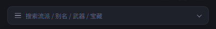
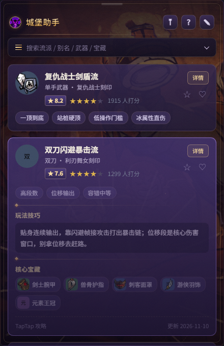
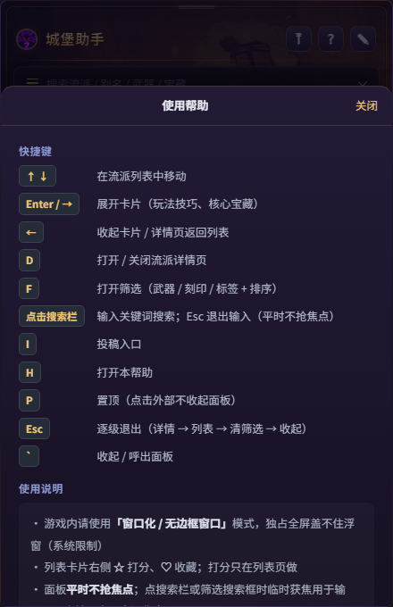

# @lc2/desktop — 客户端

Electron 桌面端的**宿主 + 渲染**。不发起请求、不做数据加工，只负责：
双窗口、全局热键、读数据源、渲染界面。

## 运行

```bash
# 在仓库根目录
npm install
npm run desktop
```

单独调试客户端：

```bash
cd apps/desktop
npm start
```

**数据源切换**（开发默认读本地 `data/`，打包后默认读 GitHub）：

```bash
LC2_DATA_SOURCE=github npm start     # 强制走 GitHub
LC2_DATA_SOURCE=local  npm start     # 强制读本地
```

## 结构

```
src/
├─ main/
│  ├─ index.js      主进程：双窗口 / 托盘 / 全局热键 / IPC / 配置持久化
│  └─ source.js     数据源层：github → 本地缓存 → 内置种子（三级降级）
├─ preload.js       contextBridge 白名单（getData / onKey / onPanel / drag*）
└─ renderer/
   └─ index.html    界面单文件（HTML+CSS+JS，无构建链）
```

## 两个窗口

| 窗口 | 尺寸 | 加载 | 职责 |
|---|---|---|---|
| `bubbleWin` | 72×72 圆形 | `?mode=bubble` | 常驻；拖拽 / 轻点开关面板 |
| `panelWin` | 440×680 | `?mode=panel` | 按需 `showInactive()`；内容与键盘 |

同一份 `index.html`，靠 URL 参数区分渲染哪部分。**两者都可独立拖动**，位置各自持久化。

## 三条不能破的规矩

1. **永远 `focusable: false`** —— 抢焦点 = 把游戏踢出全屏，工具就废了
2. **面板用 `showInactive()` 而不是 `show()`** —— 同上
3. **面板热键成对注册** —— 面板开才注册方向键，关立即注销，否则玩家游戏里方向键失灵

## 打包

```bash
npm run dist      # 产出 ../../release/LC2Helper-x.y.z-portable.exe
```

图标要求见 [assets/README.md](./图标说明.md)。

## 动效层

面板「弹出来」不再硬切，而是分两层配合：

| 层 | 做什么 | 位置 |
|---|---|---|
| **窗口级** | 面板窗口淡入（0 → 1，约 150ms ease-out）/ 淡出后隐藏 | `src/main/index.js` 的 `fadeIn / fadeOut` |
| **渲染级** | 面板整体轻微上浮 + 缩放；列表卡片逐张入场；详情页右滑进入、返回左滑；筛选从搜索栏下拉展开；Toast 上滑；收藏/打分微动效 | `renderer/index.html` 的「动效层」CSS + JS |

**方向感**：主进程会告诉渲染层「面板在气泡的哪一侧」，展开动画的 `transform-origin`
落在靠近气泡的那一边，看起来像从气泡里长出来。

### 节奏（统一变量）

```css
--m1: 150ms   /* 悬停等微反馈 */
--m2: 230ms   /* 列表 / 详情 / 弹层 */
--m3: 330ms   /* 面板整体进场 */
--me: cubic-bezier(.22, 1, .36, 1)   /* ease-out 回弹感 */
```

### 环境变量

| 变量 | 默认 | 说明 |
|---|---|---|
| `LC2_PANEL_FADE` | `1` | 设为 `0` 关闭窗口级淡入淡出 |
| `LC2_PANEL_FADE_IN_MS` | 150 | 淡入时长（毫秒） |
| `LC2_PANEL_FADE_OUT_MS` | 110 | 淡出时长（毫秒） |

> 窗口级淡入有**安全兜底**：先探测 `setOpacity` 在本机是否真的生效，
> 不生效（部分系统设置会忽略透明度）就退回直接显隐，**不会出现面板全透明看不见**。

### 无障碍

渲染层尊重 `prefers-reduced-motion`：系统开启「减少动态效果」时，动画与过渡全部关闭。

### 面板阴影是怎么来的（原生分层窗口）

**不能用"窗口留透明边距 + CSS 阴影"**：透明窗口在部分 Windows 环境下会失效，
留白会被渲染成浅灰实心框（实际踩过这个坑）。

现在的分工：

```
┌─ 原生阴影窗口（shadow.ps1）──────────────┐
│  ╭──────────────────────────────╮        │
│  │  Electron 面板窗口（不透明）  │ ← 阴影 │
│  ╰──────────────────────────────╯        │
└──────────────────────────────────────────┘
```

| 层 | 窗口 | 负责 |
|---|---|---|
| 阴影层 | `native/shadow.ps1`（WS_EX_LAYERED，逐像素 alpha，鼠标穿透） | 面板外侧的柔和阴影，位置比面板每边大 24px |
| 面板层 | Electron 窗口：**不透明** + `setShape` 圆角 16 | 全部内容与交互 |

- 阴影是**程序化生成的高斯衰减位图**，不依赖 Chromium 透明合成
- 阴影透明度跟随面板淡入淡出（`ALPHA` 指令），拖拽时同步 `MOVE`
- 面板窗口不透明，所以**任何机器上都不会出现透明残留/灰框**
- 阴影进程启动时预热（首次编译 C# 约 1 秒），面板第一次打开就有阴影

可调/可回退：

| 变量 | 默认 | 说明 |
|---|---|---|
| `LC2_PANEL_SHADOW` | `1` | 设 `0` 关闭阴影（面板仍是不透明圆角） |
| `LC2_SHADOW_PAD` | 24 | 阴影扩散范围（px） |

### 圆角：Win11 用系统圆角，Win10 走回退

| 系统 | 方案 | 效果 |
|---|---|---|
| **Windows 11** | `DwmSetWindowAttribute(DWMWA_WINDOW_CORNER_PREFERENCE=ROUND)` | 系统级抗锯齿圆角，**清晰不模糊**；半径由系统统一（约 8px） |
| **Windows 10** | `setShape` 区域裁剪（16px）+ 阴影层内部填面板色补边 | 圆角略软，但不会出现白角/灰框 |
| 无阴影进程 | 直接 `setShape` 裁剪 | 兜底可用 |

注意：Win11 上为了让 DWM 圆角生效，面板窗口**不使用 `setOpacity`**
（一旦成为 layered 窗口，系统圆角可能失效），淡入改由渲染层与阴影层承担。

> **Windows 7 不支持**：Electron 33 官方最低要求 Windows 10。
> 如果必须支持 Win7，只能降级到 Electron 22（已停止维护、无安全更新），代价很大，不建议。

### 休眠与唤醒（置顶场景）

面板默认靠全局热键工作（不抢焦点也能用方向键浏览）。一旦**窗口失焦**（点了游戏/其它窗口），
面板进入**休眠**：注销全部面板热键、保持不可聚焦——键盘完全交给游戏，不会误操作。

唤醒方式：**点击面板任意位置**（点击也会先把窗口拿回焦点，之后键盘由 DOM 事件处理）。

> 之前的行为是失焦后立刻重新注册热键，导致置顶时点外部后按键仍会操作面板，这是本轮修掉的 bug。

### 拖拽（顶部边缘条 + 原生轮询）

面板有两个拖拽区：**顶部拖拽条**（中间小横线，悬停变亮）和**标题栏空白处**。
两者共用同一套原生光标流；标题栏上的按钮（置顶/帮助/投稿）不会触发拖拽。
面板内已禁用文字选中与 Chromium 原生拖拽（`dragstart`），不会出现“图标被拖动”的幽灵效果。

拖拽位移**不在渲染层做**：主进程让辅助进程用 `GetCursorPos` 以 8ms 间隔轮询光标，
把绝对坐标流式回传，主进程据此 `setPosition`。原因：面板是 `focusable:false` 的
非激活窗口，`pointer capture` 在光标移出窗口后会失效，用 pointermove 拖拽会“拖不动/卡住”。

流程：

```
按住拖拽条（pointerdown）
  → 主进程发 DRAGSTART
  → 辅助进程等鼠标按下（≤1s），每 8ms 上报 DRAG x,y
  → 主进程 movePanelTo(cursor - 起始偏移)（带屏幕 clamp）
  → 鼠标抬起 → DRAGEND → 保存位置 / 恢复阴影 / 抬回前台
```

### 搜索与筛选

搜索栏同时承担两件事：

| 操作 | 行为 |
|---|---|
| 点击输入区域 | 输入关键词，实时过滤（匹配流派名 / 别名 / 武器 / 刻印 / 标签 / 核心宝藏 / 作者） |
| 点击 `☰` 或 `⌄` | 打开筛选下拉（武器 / 刻印 / 标签 + 排序），与关键词**同时生效** |
| `F` | 同上，打开筛选下拉 |
| `Esc` | 先清空关键词 / 退出输入；再逐级退出 |

**关于焦点**：面板平时 `focusable: false`（不抢游戏焦点），所以输入框默认收不到键盘。
点击搜索栏时主进程会临时 `setFocusable(true) + focus()`，并**注销面板热键**，让字母、
方向键、退格、输入法都进入输入框；输入结束（**窗口**失焦 / 点外部 / 关面板）立即恢复不可聚焦并重新注册热键。
注意：输入框自身失焦（例如点了下面的卡片）不算结束——窗口仍有焦点，键盘改用 DOM 事件处理，
避免「点卡片被交还焦点的动作打断」。

### 筛选入口在搜索栏

标题栏不再放筛选按钮。**点击搜索栏**（或按 `F`）从搜索栏下方**下拉**出筛选面板：

- 触发区是整个搜索栏，右侧 `⌄` 会随展开状态翻转
- 已选筛选条件会写回搜索栏占位文案，例如「已筛选：单手武器 · 评分（点此调整）」
- 搜索栏在有筛选时高亮，清空后恢复默认文案

### 置顶（📌 / P）

面板标题栏最左侧是 `📌` 图标（置顶的开关），也可以按 **P** 切换：

| 状态 | 点击面板外部 | 面板按键 |
|---|---|---|
| 未置顶（默认） | 自动收起（popover 行为） | — |
| **已置顶** | 不收起，只把输入让给外部窗口 | 仍然有效 |

- 置顶状态存进 `config.json`（`panelPinned`），重启保持
- 实现：原生进程轮询全局左键 → 主进程判断坐标；置顶时直接忽略
- 键盘流：`P` 在面板里随时可切；置顶时图标高亮（绿色）

## 开发热部署

非打包环境（`npm run desktop`）默认开启热部署，改完立刻生效，不用重启：

| 改动 | 行为 |
|---|---|
| `src/renderer/index.html`（界面 / 样式 / Interaction） | 窗口自动 `reloadIgnoringCache()`，约 0.3s 后看到效果 |
| `data/*.json`（本地数据源） | 自动重载界面，重新读数据 |
| `native/bubble.ps1`、`native/shadow.ps1` | 自动重启对应原生进程（气泡 / 阴影），并重新探测圆角模式 |
| `src/main/*.js`、`preload.js` | **无法热重载**，控制台会提示「需要重启」 |

开关：

```powershell
npm run desktop                    # 默认开启（dev 环境）
$env:LC2_HOT='0'; npm run desktop  # 关闭热部署
```

注意：

- 渲染层重载会**丢失当前界面状态**（滚动位置、展开的卡片、详情页），但面板开合与置顶状态会由主进程重新下发
- 开发数据源默认是本地（`dataSource: local`），热重载读的也是本地 JSON；如果强制 `LC2_DATA_SOURCE=github`，改本地数据不会生效
- 服务端本来就是 `node --watch`（`npm run server` 时用的是 `start`，热重启请用 `npm run dev -w @lc2/server`）

### 搜索栏排版

搜索栏固定 38px 高，三个元素统一 16px 网格垂直居中：

```
[☰ 16px]  输入框（flex:1，高度铺满，文字垂直居中）  [⌄ 16px]
```

实际渲染（`capturePage` 截取）：



- 左右图标固定 16×16，用 flex 居中，不再靠 padding 拼对齐
- 输入框 `height:100%`，文字基线与图标中心对齐
- `⌄` 只在筛选下拉展开时旋转 180°，平时不旋转

### 终端乱码（Windows）

控制台默认代码页是 **936(GBK)**，而 Node/Electron 输出是 **UTF-8**，中文日志会变成「杈呭姪杩涚▼」这类乱码。

已处理：

- `npm run desktop` 启动脚本里先 `chcp 65001 >nul` 再启动 Electron
- 主进程启动时兜底再执行一次 `chcp 65001`（直接 `electron .` 也生效）
- 服务端 `npm run server` / `npm run server:dev` 同样处理

如果仍乱码，在当前 PowerShell 里执行：

```powershell
[Console]::OutputEncoding = [Text.Encoding]::UTF8
```

### 气泡光环动画

| 状态 | 效果 |
|---|---|
| **默认（未悬停）** | 光环**慢速自转**（原生约 9 秒/圈；CSS 回退版 14 秒/圈） |
| **悬停** | 加速旋转（原生约 1.7 秒/圈；CSS 回退版 1.6 秒/圈），同时提亮 + 图标轻微放大 |

两处实现都用「光标位置」兜底校正悬停状态，避免鼠标离开事件丢失导致速度卡在错误状态：

- 原生：`OnTick` 里每帧检查光标是否在气泡内，自动切换空闲/悬停节奏
- CSS 回退：`.ring` 常驻 `ringSpin 14s`，`:hover` 时改为 `1.6s`
- 原生气泡接管成功时会销毁可能残留的 Electron 气泡窗口，避免双气泡叠加

### 孤儿进程清理（气泡/阴影）

原生 helper（`bubble.ps1` / `shadow.ps1`）是独立 PowerShell 进程，正常情况下由 Electron
通过 stdin 发 `QUIT` 关闭。但如果 Electron 被强杀/崩溃，子进程可能残留 —— 表现为屏幕上
多出一个（或几个）气泡图标。

现在有三层保障：

| 机制 | 说明 |
|---|---|
| **父进程看门狗** | helper 启动时带 `-ParentPid <electron pid>`，每 1s 检查父进程；父进程消失 → 1s 内自动关闭窗口 |
| **stdin EOF** | Electron 退出后 stdin 管道关闭，helper 读取到 EOF 也会关闭窗口 |
| **启动时清理** | 每次启动先扫描并终止上次遗留的 `native\bubble.ps1` / `native\shadow.ps1` 进程（排除自身） |

排查：屏幕出现多余气泡时，可在 PowerShell 执行

```powershell
Get-CimInstance Win32_Process | Where-Object { $_.CommandLine -match 'native\(bubble|shadow)\.ps1' }
```

有输出说明是残留进程，用 `Stop-Process -Id <pid> -Force` 结束即可（新版本启动时会自动清）。

### 界面皮肤（失落城堡2 风格）

面板不再是通用深灰卡片，而是按游戏氛围重做的「虚空紫 + 金线」皮肤：

| 元素 | 设计 |
|---|---|
| 面板底 | **官方营地加载背景图：阿姆斯特朗举杯、众人围火欢庆**，暗化 + 暖色补光后作为底纹 |
| 金线边框 | 内嵌 1px 金线 + 四角金色括号与菱形铆钉 |
| 标题 | 金色渐变文字 + 下金属分割线 |
| 卡片 | 紫罗兰半透明「玻璃」底 + 金线描边，选中态紫色辉光 |
| 分割/标题 | 金色渐变细线 + 菱形标记（`.sec`） |
| 按钮/搜索栏 | 深紫玻璃 + 金色悬停描边，筛选展开时紫色辉光 |


详情页展开态：



> 背景图来自 [失落城堡2中文维基 · 营地](https://lc2.huijiwiki.com/wiki/%E8%90%A5%E5%9C%B0) 的加载背景图（© Hunter Studio），仅非商业本地展示；
> 源图存 `assets/source/panel-bg-src.jpg`，由 `scripts/make-panel-bg.ps1` 裁成 880×1360 的 `assets/panel-bg.jpg`，
> 随 electron-builder `files` 一起打包，离线可用。

### 弹层层级

面板内容（列表/详情）在皮肤里被设为 `position:relative; z-index:1` 形成层叠上下文，
所以弹层必须显式抬高层级，否则会被卡片盖住：

- `.modal`（帮助 / 筛选）→ `z-index:30`
- `.toast`（提示条）→ `z-index:40`



### 打分悬停预览

详情页的评分条支持悬停预览：鼠标停在第 N 颗星时，前 N 颗一起亮起并放大、
右侧提示改成「评 N 星（点击确认）」；移开后恢复显示「已投 X 星」或「点星选择」。

实现：事件委托监听 `.ratepick .rp` 的 `mouseover/mouseout`，只加 `.preview/.dim`
临时类，不改变真实投票状态；点击才写入 `state.myVote`。


