# @lc2/desktop — 客户端

Electron 桌面端的**宿主 + 渲染**。不发起请求、不做数据加工，只负责：
双窗口、全局热键、读数据源、渲染界面。

## 运行

```bash
# 在仓库根目录
npm install
npm run desktop
```

单独调试客户端：

```bash
cd apps/desktop
npm start
```

**数据源切换**（开发默认读本地 `data/`，打包后默认读 GitHub）：

```bash
LC2_DATA_SOURCE=github npm start     # 强制走 GitHub
LC2_DATA_SOURCE=local  npm start     # 强制读本地
```

## 结构

```
src/
├─ main/
│  ├─ index.js           主进程入口（组合根：启动顺序 / 依赖组装 / 退出清理）
│  ├─ panel.js           面板窗口控制器（显隐 / 拖拽 / 休眠 / 圆角 / 焦点）
│  ├─ bubble-window.js   Electron 气泡窗口（原生分层气泡的兜底）
│  ├─ config.js          用户配置（校验 / 原子写 / 防抖落盘）
│  ├─ notes-store.js     用户印象 JSON 存储
│  ├─ data.js            数据加载（包装 source 层）
│  ├─ geometry.js        窗口几何（纯函数）
│  ├─ shape.js           setShape 圆角兜底
│  ├─ tray.js            托盘
│  ├─ shortcuts.js       全局热键
│  ├─ ipc.js             IPC 白名单
│  ├─ hot-reload.js      开发热部署
│  ├─ source.js          数据源层：github → 本地缓存 → 内置种子（三级降级）
│  ├─ nativeBubble.js    原生气泡 helper 封装
│  └─ panelShadow.js     原生阴影 / DWM 圆角 / 全局点击 helper 封装
├─ preload.js       contextBridge 白名单（getData / notes / onKey / onPanel / drag*）
└─ renderer/        渲染层（无构建链，经典脚本 + window.LC2 命名空间）
   ├─ index.html    结构壳：只放 DOM + <link> / <script>
   ├─ styles/       base.css（基础布局）+ skin.css（失落城堡2 皮肤）
   └─ js/
      ├─ data/catalog.js        静态目录（武器/刻印/宝藏/标签；流派已清空）
      ├─ domain/builds.js       领域规则（筛选/搜索/排序/归一化，可单测）
      ├─ infra/repositories.js  数据源 / 印象持久化
      ├─ ui/{icons,dom,motion}.js  图标 / DOM 工具 / 动效
      └─ app.js                 应用层：状态、视图、交互、Electron 适配
```

渲染层分层见 [前端架构](./前端架构.md)，主进程模块见 [主进程架构](./主进程架构.md)。

## 两个窗口

| 窗口 | 尺寸 | 加载 | 职责 |
|---|---|---|---|
| `bubbleWin` | 72×72 圆形 | `?mode=bubble` | 常驻；拖拽 / 轻点开关面板 |
| `panelWin` | 440×680 | `?mode=panel` | 按需 `showInactive()`；内容与键盘 |

同一份 `index.html`，靠 URL 参数区分渲染哪部分。**两者都可独立拖动**，位置各自持久化。

## 三条不能破的规矩

1. **永远 `focusable: false`** —— 抢焦点 = 把游戏踢出全屏，工具就废了
2. **面板用 `showInactive()` 而不是 `show()`** —— 同上
3. **面板热键成对注册** —— 面板开才注册方向键，关立即注销，否则玩家游戏里方向键失灵

## 打包

```bash
npm run dist      # 从仓库根目录执行，生成 release/LC2Helper-x.y.z-win-x64-setup.exe
```

安装包适用于 Windows 10/11 x64，可选择安装目录。安装后从开始菜单启动 **LC2 Helper**，也可在 Windows「设置 → 应用」中卸载。安装包自带 Electron。

需要免安装版本时，从仓库根目录执行 `npm run dist -w @lc2/desktop -- --win portable --x64`，生成 `release/LC2Helper-x.y.z-portable.exe`。

图标要求见 [assets/README.md](./图标说明.md)。

## 动效层

面板「弹出来」不再硬切，而是分两层配合：

| 层 | 做什么 | 位置 |
|---|---|---|
| **窗口级** | 面板窗口淡入（0 → 1，约 150ms ease-out）/ 淡出后隐藏 | `src/main/index.js` 的 `fadeIn / fadeOut` |
| **渲染级** | 面板整体轻微上浮 + 缩放；列表卡片逐张入场；详情页右滑进入、返回左滑；筛选弹层：260ms 短距位移 + 透明度（无缩放），关闭 160ms 轻量收起；Toast 上滑；收藏/打分微动效 | `renderer/js/ui/motion.js` 的钩子 + `styles/` 的动效类 + JS |

**方向感**：主进程会告诉渲染层「面板在气泡的哪一侧」，展开动画的 `transform-origin`
落在靠近气泡的那一边，看起来像从气泡里长出来。

### 节奏（统一变量）

```css
--m1: 150ms   /* 悬停等微反馈 */
--m2: 230ms   /* 列表 / 详情 / 弹层 */
--m3: 330ms   /* 面板整体进场 */
--me: cubic-bezier(.22, 1, .36, 1)   /* ease-out 回弹感 */
```

### 环境变量

| 变量 | 默认 | 说明 |
|---|---|---|
| `LC2_PANEL_FADE` | `1` | 设为 `0` 关闭窗口级淡入淡出 |
| `LC2_PANEL_FADE_IN_MS` | 150 | 淡入时长（毫秒） |
| `LC2_PANEL_FADE_OUT_MS` | 110 | 淡出时长（毫秒） |

> 窗口级淡入有**安全兜底**：先探测 `setOpacity` 在本机是否真的生效，
> 不生效（部分系统设置会忽略透明度）就退回直接显隐，**不会出现面板全透明看不见**。

### 无障碍

渲染层尊重 `prefers-reduced-motion`：系统开启「减少动态效果」时，动画与过渡全部关闭。

### 面板阴影是怎么来的（原生分层窗口）

**不能用"窗口留透明边距 + CSS 阴影"**：透明窗口在部分 Windows 环境下会失效，
留白会被渲染成浅灰实心框（实际踩过这个坑）。

现在的分工：

```
┌─ 原生阴影窗口（shadow.ps1）──────────────┐
│  ╭──────────────────────────────╮        │
│  │  Electron 面板窗口（不透明）  │ ← 阴影 │
│  ╰──────────────────────────────╯        │
└──────────────────────────────────────────┘
```

| 层 | 窗口 | 负责 |
|---|---|---|
| 阴影层 | `native/shadow.ps1`（WS_EX_LAYERED，逐像素 alpha，鼠标穿透） | 面板外侧的柔和阴影，位置比面板每边大 24px |
| 面板层 | Electron 窗口：**不透明** + `setShape` 圆角 16 | 全部内容与交互 |

- 阴影是**程序化生成的高斯衰减位图**，不依赖 Chromium 透明合成
- 阴影透明度跟随面板淡入淡出（`ALPHA` 指令），拖拽时同步 `MOVE`
- 面板窗口不透明，所以**任何机器上都不会出现透明残留/灰框**
- 阴影进程启动时预热（首次编译 C# 约 1 秒），面板第一次打开就有阴影

可调/可回退：

| 变量 | 默认 | 说明 |
|---|---|---|
| `LC2_PANEL_SHADOW` | `1` | 设 `0` 关闭阴影（面板仍是不透明圆角） |
| `LC2_SHADOW_PAD` | 24 | 阴影扩散范围（px） |

### 圆角：Win11 用系统圆角，Win10 走回退

| 系统 | 方案 | 效果 |
|---|---|---|
| **Windows 11** | `DwmSetWindowAttribute(DWMWA_WINDOW_CORNER_PREFERENCE=ROUND)` | 系统级抗锯齿圆角，**清晰不模糊**；半径由系统统一（约 8px） |
| **Windows 10** | `setShape` 区域裁剪（16px）+ 阴影层内部填面板色补边 | 圆角略软，但不会出现白角/灰框 |
| 无阴影进程 | 直接 `setShape` 裁剪 | 兜底可用 |

注意：Win11 上为了让 DWM 圆角生效，面板窗口**不使用 `setOpacity`**
（一旦成为 layered 窗口，系统圆角可能失效），淡入改由渲染层与阴影层承担。

> **Windows 7 不支持**：Electron 33 官方最低要求 Windows 10。
> 如果必须支持 Win7，只能降级到 Electron 22（已停止维护、无安全更新），代价很大，不建议。

### 休眠与唤醒（置顶场景）

面板默认靠全局热键工作（不抢焦点也能用方向键浏览）。一旦**窗口失焦**（点了游戏/其它窗口），
面板进入**休眠**：注销全部面板热键、保持不可聚焦——键盘完全交给游戏，不会误操作。

唤醒方式：**点击面板任意位置**（点击也会先把窗口拿回焦点，之后键盘由 DOM 事件处理）。
再次点击主搜索框或筛选弹层的搜索框时，可接着输入原有关键词。窗口失焦时取消尚未执行的获焦重试。

> 之前的行为是失焦后立刻重新注册热键，导致置顶时点外部后按键仍会操作面板，这是本轮修掉的 bug。

### 版本与更新

点击标题栏右侧的设置图标，在「版本」区查看当前客户端版本、本次更新内容和图鉴署名，并检查新版本。发现新版本后可点击「前往下载」。点击关闭按钮、点弹层外部或按 `Esc` 可退出设置。

根 `package.json` 是版本号的唯一来源。普通提交时，pre-commit 钩子自动递增补丁版本，并同步到各 workspace 和 `package-lock.json`。Electron 通过 `app.getVersion()` 读取当前启动的客户端包版本。开发环境重启客户端即可读到同步后的版本，便携版显示打包时的版本。

更新说明随客户端发布，发布时维护 `apps/desktop/src/renderer/js/data/update-notes.js`。

### 气泡右键菜单

右键点击悬浮气泡，菜单默认在气泡正下方居中显示。下方空间不足时，菜单移到气泡上方。原生气泡和 Electron 备用气泡都支持这两个操作。
拖动气泡、点击菜单外部或按 `Esc` 都会收起菜单。菜单打开时，`Esc` 优先收起菜单。

- **重启**会保存配置、退出并重新打开城堡助手。
- **隐藏**会收起气泡和面板。系统托盘菜单里的「显示气泡」只恢复气泡。点击气泡或按热键可打开面板。

原生气泡通过 `RCLICK` 通知主进程，Electron 备用气泡通过 `context-menu` 事件通知主进程，两者共用同一份 Electron 菜单。
便携版从外层启动器重启，每次启动使用独立的临时解包目录，避免上一个启动器清理时影响新进程。

### 拖拽（顶部边缘条 + 主进程轮询）

面板有两个拖拽区：**顶部拖拽条**（中间小横线，悬停变亮）和**标题栏空白处**。
两者共用同一套拖拽逻辑；标题栏上的按钮（置顶/帮助/投稿）不会触发拖拽。
面板内已禁用文字选中与 Chromium 原生拖拽（`dragstart`），不会出现“图标被拖动”的幽灵效果。

拖拽位移**不在渲染层做**：面板是 `focusable:false` 的非激活窗口，`pointer capture`
在光标移出窗口后会失效，用 pointermove 拖拽会“拖不动/卡住”。

实现：按住后**主进程**以 8ms 轮询 `screen.getCursorScreenPoint()`，直接 `setPosition`：

- 少了 helper→stdout→IPC 的一道转发，抖动更小
- 相同整数坐标不重复 `setPosition`；去掉了“每 12 次移动重设置顶”的周期性卡顿
- 辅助进程的拖拽流只负责检测“鼠标在窗口外松开”（`DRAGEND`），上报坐标不再驱动窗口
- 松开时补最后一帧位置，再保存位置 / 恢复阴影 / 抬回前台
- 非 1.0 DPI 下会自动判断 cursor 坐标是 DIP 还是物理像素（用按下点误差比较）

流程：

```
按住拖拽条（pointerdown）
  → 主进程建 8ms 计时器轮询光标
  → setPosition(cursor - 起始偏移)
  → 鼠标抬起（窗内 renderer / 窗外 helper）→ 停表 + 补最后一帧
  → 保存位置 / 恢复阴影 / 抬回前台
```

### 搜索与筛选

搜索栏支持以下操作：

| 操作 | 行为 |
|---|---|
| 点击输入区域 | 输入关键词，实时过滤（匹配流派名 / 别名 / 武器 / 刻印 / 标签 / 宝藏 / 作者） |
| 点击箭头左侧的 `×` | 清空主搜索栏关键词，保留已选筛选条件。输入框有内容时显示 |
| 点击右上角 **投稿**（`I`） | 打开投稿编辑器（多页面切换），从图鉴点选武器/刻印/装备/衣服/宝藏/灵魂石/诅咒宝藏，底部「查看已选」进入复查页，确认后提交 |
| 点击左侧漏斗图标 或 `⌄` | 打开筛选弹层（武器类型 / 刻印 / 装备 / 衣服 / 宝藏 + 标签，可多选），与关键词**同时生效** |
| 筛选弹层内**悬停图鉴** | 小窗会在底部提示「拉宽窗口可查看图鉴详情」；把窗口拖宽后，右侧自动显示说明、效果、属性 |
| `F` | 同上，打开筛选下拉 |
| `Esc` | 先清空关键词 / 退出输入；再逐级退出 |

**关于焦点**：面板平时 `focusable: false`（不抢游戏焦点），所以输入框默认收不到键盘。
点击搜索栏时主进程会临时 `setFocusable(true) + focus()`，并**注销面板热键**，让字母、
方向键、退格、输入法都进入输入框；输入结束（**窗口**失焦 / 点外部 / 关面板）立即恢复不可聚焦并重新注册热键。
注意：输入框自身失焦（例如点了下面的卡片）不算结束——窗口仍有焦点，键盘改用 DOM 事件处理，
避免「点卡片被交还焦点的动作打断」。

### 流派卡片的信息层级

卡片按「一眼扫到 → 想细看 → 要操作」分层，**颜色只用来分层，不靠装饰堆视觉**：

| 层 | 内容 | 处理 |
|---|---|---|
| 视觉锚点 | 武器图标 | 52×56px 深色装备底座，品类色沿底座衬托图像；优先使用主武器图标 |
| 主信息 | 流派名 + 徽章 | 名称 17px/650 暖白、超出省略；右侧最多挂一枚低对比徽章：高分或热门 |
| 次信息 | 品类行 | `● 法杖 · 奥术大师刻印`：圆点只标武器类型（颜色 = 品类色），刻印不重复点，用更暗的文字区分 |
| 量化信息 | 评分 | 低饱和暖金数字 + 低对比 `/10` 与评分人数。窄窗在品类下方同排，560px 起在右侧独立成列，分数在上、人数在下。评分与人数均为零时显示「暂无评分」 |
| 玩法线索 | 一句话技巧 | 最多显示两行，完整玩法在详情页查看 |
| 底栏 | 特征 chip + 三个操作 | 细分隔线下左侧为标签、右侧为打分/收藏/印象，垂直居中对齐 |
| 操作 | 详情 | 右上仅显示箭头；点击卡面或箭头均进入详情页，Enter / → 同样打开当前流派；← 返回列表 |

**卡片头部使用 grid**（`.ch`）：窄窗为图标、名称与品类、箭头三列，评分在名称列下方。560px 起增加右侧评分列，最小宽度 80px，随人数文本增长；分数与人数整体右对齐，箭头位于末列。图标、主信息、评分与箭头保持垂直居中。

列表概览显示分数与人数。详情评分显示分数、星级和人数。未评分时显示「暂无评分」。
面板最小宽度锁定在 440（`panel.js` 的 `setSize`），所以只有变宽一种情况要处理。

**卡面材质**采用暖炭紫半透明衬底，让营地底图透过卡片；背景模糊 3px，暗色渐变承托文字。悬停时卡片上浮 3px，边框与投影增强，局部柔光跟随光标。武器图像放大并轻微转动，右上箭头向右移动；离开时各元素平滑复位。系统开启减少动态效果时只保留颜色反馈。

**选中态只做一点点**：边框 `.15 → .34`、卡面各层亮度 +2% 左右、一圈极淡外发光（`0 0 12px rgba(255,190,90,.05)`）。
**不要加侧边金条**——列表里最响的应该是内容，选中只需要"看得出是这张"。

品类色是**表现层**定义（`ui/icons.js` 的 `WC` / `weaponTint()`），不进数据、不影响筛选；新增武器类型时在这里补色，缺省灰蓝 `#8B93A6`。

### 排序（列表工具栏）

排序是**列表级操作**，不放在筛选弹层里：

- `最新` / `人气` / `评分` 位于搜索栏下方右侧，**默认 `最新`（由近到远）**。应用筛选时，筛选标签显示在排序上方，清空按钮在标签行右侧。选中的排序项用金色和短下划线标示。
- 时间排序取 `createdAt`（投稿时间），缺省退回 `updatedAt` / `updated`（最后更新）；两者都取不到就沉到最后。同一时间戳的人气高者在前，顺序稳定可复现。
- **换排序后默认选中结果里的第一条**：列表顺序整体变了，高亮若停在原来那张卡上会像点错了，所以统一切到第一条并回到列表顶部。
- 滚动跳转按钮在排序行左侧，以「一个视口」为触发距离：向下滚过一屏显示「回到顶部」，距底部不足一屏时隐藏；离底部还有一屏以上时显示「去底部」。长列表（超过两屏）里两个按钮会同时出现，互不遮挡。两者都只动滚动位置，保留当前搜索、筛选和排序。滚动时卡片经过列表上沿会渐隐，和固定的工具栏分开。
- 筛选弹层提供武器、刻印、标签和宝藏条件。

### 空状态（统一组件）

面板和弹层里的「没数据」状态共用同一个组件（`emptyState()`）：

- 同一只小狗图标 + 标题 + 副文案的层级，图标带轻微浮动动画（弹层版同样有动画，只是尺寸小一号）
- 面板里是**大字版**（`流` 为空时），弹层里是**紧凑版**（筛选无结果 / 没数据时）
- 文案区分两种原因：
  - 没有数据：「还没有流派标签 / 有流派带上标签后，就能在这里筛选。」
  - 搜索无结果：「没有匹配的标签 / 换个关键词试试看」

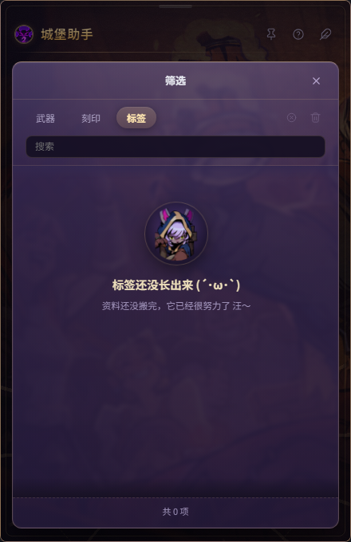

### 筛选入口在搜索栏

点击搜索栏的漏斗或 `⌄`（也可按 `F`），从搜索栏下方展开筛选面板。

- 右侧 `⌄` 会随展开状态翻转
- 已选条件**不再塞进占位文案**，改为搜索栏下方一排**可删除的筛选标签**：
  每个已选项一个标签，点 `×` 单独移除
- **筛选多时单行折叠**：放不下的 chip 收成 `+N`，点它就打开筛选弹层管理；
  工具栏高度固定，不会无限往下堆
- 列表页的垃圾桶在**筛选标签行最右**（有筛选时才出现）；弹层里在**页签行右侧**，都是图标 + tooltip：
  - 圆圈 ×：清空当前类（如刻印），tooltip 显示「清空刻印（N）」
  - 垃圾桶：全部清空，只有其他大类也有选择时才可用
  - 没得清时图标保留但置灰（`.disabled`），不会出现空白或布局跳动
  - 两个动作都会 toast 具体范围（如「已清空刻印筛选」「已清空全部筛选」）
- **支持多选**：同一类里是「或」（双刀或法杖都看），不同类之间是「且」（武器 + 标签同时满足）
- 列表标签行右侧有**垃圾桶图标**（有筛选时才出现）：一键清空全部筛选，无需要打开弹层
- 搜索框获得输入焦点或已有筛选条件时，搜索栏显示紫色辉光。普通悬停显示浅金色描边。标签行只在列表页显示，进详情自动隐藏。
- 关键词仍直接在搜索框输入，和筛选标签**同时生效**
- 筛选弹层的搜索框有内容时，点击右侧 `×` 可清空搜索词并恢复当前分类的选项列表，已选条件保留。
- 筛选弹层**加高到接近整屏**；列表右侧是**半隐滚动条**：默认不可见，悬停或滚动时隐约浮现；底部只显示「共 N 项」
- 弹层**高度固定**，切换页签时底边保持一致，内容多时列表内部滚动。
- 背景比面板亮一档（顶部 #3B2D5C → 底部 #291F41），只留 10% 的营地肌理，配金色内描边
- 筛选项使用透明底，图标加载失败时显示浅紫色首字。点选只更新选中项的文字颜色和勾标，列表保留原来的图标与滚动位置。
- 列表是 **4 列等分网格**，图标在各自格子里居中。底部显示数量，图鉴署名和许可可在设置的「版本」区查看。
- 顶部「武器 / 刻印 / 装备 / 衣服 / 宝藏 / 标签」用**滑动指示块**切换，切换时列表轻量淡入位移（180ms）
  - 武器 = 9 大武器类型（按 `wt` 筛选）
  - 刻印 = 27 个（9 类 × 3）
  - 装备 = **353 件具体武器**（按装备名匹配 `gear.weapon` / `weaponChoices` / `transition` / `core`）
  - 衣服 = **120 件防具**（轻甲 44 / 布甲 40 / 重甲 36，按 `gear.armor.name` 匹配）
  - 宝藏 = 397 个全量目录
  - 标签 = 从当前已加载的流派中抽取，按关联流派数排序，卡片显示各标签对应的流派总数。可搜索、多选并与武器等其他条件组合。
- **宝藏筛选**读取 `data/treasures.json`（397 条，来源灰机 wiki，CC BY-NC-SA 4.0，revid 139825）；
  图标已接入 396 条（`Data:Item/PassiveProps*`），仅「分解精通」无图标、回退名称首字

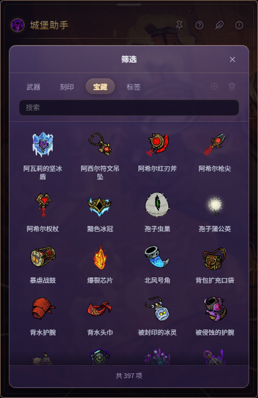

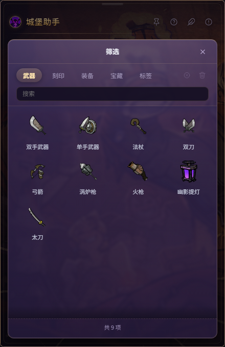

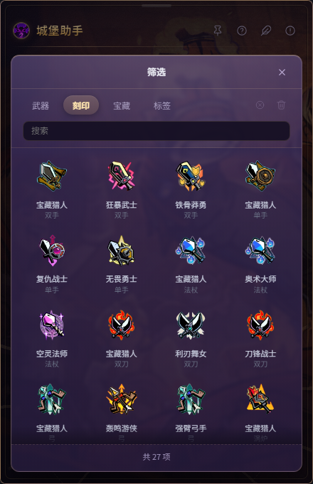

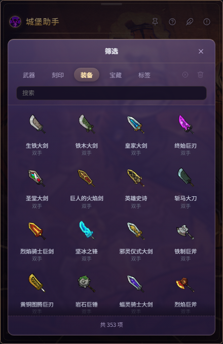

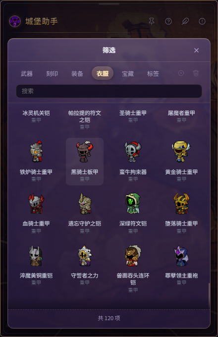

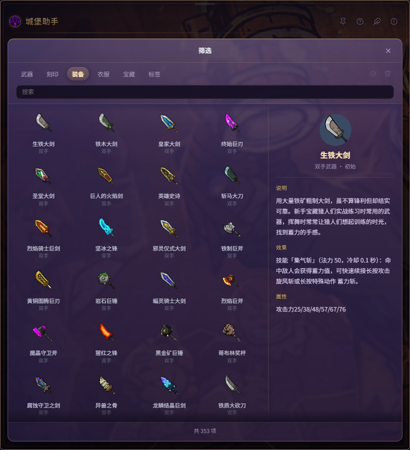
- 「宝藏」从已加载流派提取混沌、合成金、诅咒及其他宝藏名称。同类多选时命中任一项即可，与其他类别同时生效。没有流派宝藏时显示空状态。
- **选中即生效**：没有「确认/取消」按钮，右上角 × 关闭（点遮罩 / Esc 同样关闭），关闭后筛选保持

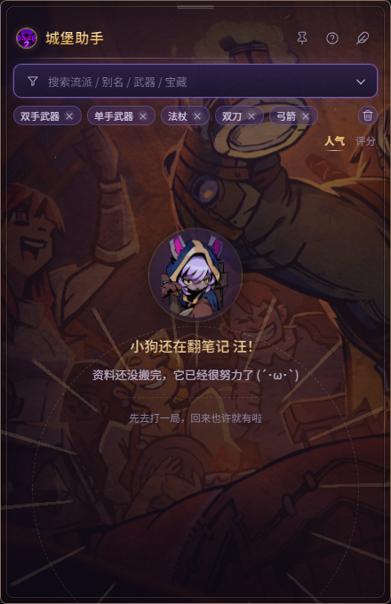


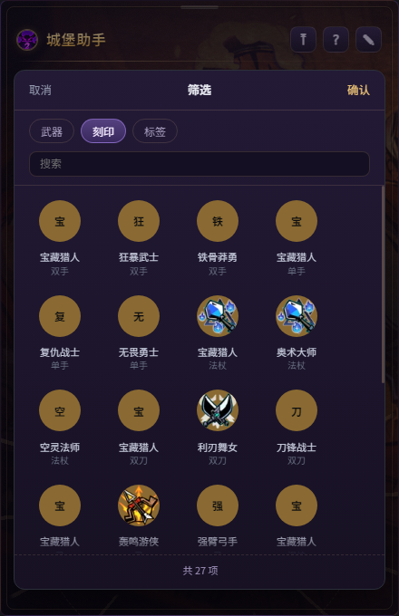

### 置顶（📌 / P）

面板标题栏最左侧是 `📌` 图标（置顶的开关），也可以按 **P** 切换：

| 状态 | 点击面板外部 | 面板按键 |
|---|---|---|
| 未置顶（默认） | 自动收起（popover 行为） | — |
| **已置顶** | 不收起，只把输入让给外部窗口 | 仍然有效 |

- 置顶状态存进 `config.json`（`panelPinned`），重启保持
- 实现：原生进程轮询全局左键 → 主进程判断坐标；置顶时直接忽略
- 键盘流：`P` 在面板里随时可切；置顶时图标高亮（绿色）

## 开发热部署

非打包环境（`npm run desktop`）默认开启热部署，改完立刻生效，不用重启：

| 改动 | 行为 |
|---|---|
| `src/renderer/**`（html / css / js / 图片，递归监听） | 窗口自动 `reloadIgnoringCache()`，约 0.3s 后看到效果 |
| `data/*.json`（本地数据源） | 自动重载界面，重新读数据 |
| `native/bubble.ps1`、`native/shadow.ps1` | 自动重启对应原生进程（气泡 / 阴影），并重新探测圆角模式 |
| `src/main/*.js`、`preload.js` | **无法热重载**，控制台会提示「需要重启」 |

开关：

```powershell
npm run desktop                    # 默认开启（dev 环境）
$env:LC2_HOT='0'; npm run desktop  # 关闭热部署
```

注意：

- 渲染层重载会**丢失当前界面状态**（滚动位置、详情页），但面板开合与置顶状态会由主进程重新下发
- 开发数据源默认是本地（`dataSource: local`），热重载读的也是本地 JSON；如果强制 `LC2_DATA_SOURCE=github`，改本地数据不会生效
- 开发时可将模拟流派数据保存为 `data/builds.local.json`。普通 `npm run desktop` 启动会优先读它，文件随项目保留，修改后会热重载。移走文件即可恢复读取 `data/builds.json`。本地预览文件由 Git 忽略，安装包也会排除它。
- 服务端本来就是 `node --watch`（`npm run server` 时用的是 `start`，热重启请用 `npm run dev -w @lc2/server`）

### 搜索栏排版

搜索栏固定 38px 高，输入框和图标垂直居中：

```
[漏斗 16px]  输入框（flex:1，高度铺满，文字垂直居中）  [× 有内容时显示]  [⌄ 16px]
```

实际渲染（`capturePage` 截取）：

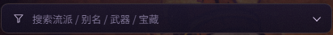

- 左右图标固定 16×16，用 flex 居中，不再靠 padding 拼对齐
- 输入框 `height:100%`，文字基线与图标中心对齐
- `⌄` 只在筛选下拉展开时旋转 180°，平时不旋转

### 终端乱码（Windows）

控制台默认代码页是 **936(GBK)**，而 Node/Electron 输出是 **UTF-8**，中文日志会变成「杈呭姪杩涚▼」这类乱码。

已处理：

- `npm run desktop` 启动脚本里先 `chcp 65001 >nul` 再启动 Electron
- 主进程启动时兜底再执行一次 `chcp 65001`（直接 `electron .` 也生效）
- 服务端 `npm run server` / `npm run server:dev` 同样处理

如果仍乱码，在当前 PowerShell 里执行：

```powershell
[Console]::OutputEncoding = [Text.Encoding]::UTF8
```

### 气泡光环动画

| 状态 | 效果 |
|---|---|
| **默认（未悬停）** | 光环**慢速自转**（原生约 9 秒/圈；CSS 回退版 14 秒/圈），低饱和 pastel 配色 |
| **悬停** | 加速旋转（原生约 1.7 秒/圈；CSS 回退版 1.6 秒/圈），同时提亮 + 图标轻微放大 |

两处实现都用「光标位置」兜底校正悬停状态，避免鼠标离开事件丢失导致速度卡在错误状态：

- 原生：`OnTick` 里每帧检查光标是否在气泡内，自动切换空闲/悬停节奏
- CSS 回退：`.ring` 常驻 `ringSpin 14s`，`:hover` 时改为 `1.6s`
- 原生气泡接管成功时会销毁可能残留的 Electron 气泡窗口，避免双气泡叠加

### 孤儿进程清理（气泡/阴影）

原生 helper（`bubble.ps1` / `shadow.ps1`）是独立 PowerShell 进程，正常情况下由 Electron
通过 stdin 发 `QUIT` 关闭。但如果 Electron 被强杀/崩溃，子进程可能残留 —— 表现为屏幕上
多出一个（或几个）气泡图标。

现在有三层保障：

| 机制 | 说明 |
|---|---|
| **父进程看门狗** | helper 启动时带 `-ParentPid <electron pid>`，每 1s 检查父进程；父进程消失 → 1s 内自动关闭窗口 |
| **stdin EOF** | Electron 退出后 stdin 管道关闭，helper 读取到 EOF 也会关闭窗口 |
| **启动时清理** | 每次启动先扫描并终止上次遗留的 `native\bubble.ps1` / `native\shadow.ps1` 进程（排除自身） |

排查：屏幕出现多余气泡时，可在 PowerShell 执行

```powershell
Get-CimInstance Win32_Process | Where-Object { $_.CommandLine -match 'native\(bubble|shadow)\.ps1' }
```

有输出说明是残留进程，用 `Stop-Process -Id <pid> -Force` 结束即可（新版本启动时会自动清）。

### 界面皮肤（失落城堡2 风格）

面板不再是通用深灰卡片，而是按游戏氛围重做的「虚空紫 + 金线」皮肤：

| 元素 | 设计 |
|---|---|
| 面板底 | **官方营地加载背景图：阿姆斯特朗举杯、众人围火欢庆**，暗化 + 暖色补光后作为底纹 |
| 金线边框 | 内嵌 1px 金线 + 四角金色括号与菱形铆钉 |
| 标题 | 金色渐变文字 + 下金属分割线 |
| 流派卡片 | 暖炭紫半透明衬底与轻度背景模糊，悬停时卡片上浮、边框增强、局部柔光跟随光标，武器放大轻转、右上箭头右移；评分突出数字，底栏左侧标签、右侧操作 |
| 流派详情 | 更沉的暖紫底承托正文，宝藏卡片和展开的等级表用同色系内层区分 |
| 分割/标题 | 金色渐变细线 + 菱形标记（`.sec`） |
| 按钮/搜索栏 | 深紫玻璃 + 金色悬停描边，筛选展开时紫色辉光 |


详情页展开态：


> 背景图来自 [失落城堡2中文维基 · 营地](https://lc2.huijiwiki.com/wiki/%E8%90%A5%E5%9C%B0) 的加载背景图（© Hunter Studio），仅非商业本地展示；
> 源图存 `assets/source/panel-bg-src.jpg`，由 `scripts/make-panel-bg.ps1` 裁成 880×1360 的 `assets/panel-bg.jpg`，
> 随 electron-builder `files` 一起打包，离线可用。

### 弹层层级

面板内容（列表/详情）在皮肤里被设为 `position:relative; z-index:1` 形成层叠上下文，
所以弹层必须显式抬高层级，否则会被卡片盖住：

- `.modal`（帮助 / 筛选 / 投稿 / 印象）→ `z-index:30`
- `.toast`（提示条）→ `z-index:60`，且必须是 `.panel` 的**兄弟节点**
- `.rz`（面板边缘缩放手柄）→ `z-index:20`，低于弹层：弹层打开时不该还能拖边缘，
  也不能挡住弹窗四角的点击（早先设成 80，印象弹窗左上角那块点不到就是它挡的）

`.modal` 和 `.panel` 是平级兄弟，面板在 Electron 面板模式下是 `position:fixed`，自成一个层叠上下文：
提示条如果留在面板内部，`z-index` 再高也只能盖住面板内容，弹层一打开提示就被整块遮住
（表现为「点了提交没反应」——校验提示其实弹了，只是在弹层下面）。所以 `#toast` 挂在 `.desktop` 下，
并显式高于 `.modal`；气泡窗口 72×72 不显示提示条。

### 弹层怎么关

带输入框的弹层（目前是「写点印象 / 评价」）三条关闭路径都要在：

1. 弹层头部的「取消」，放弃本次编辑并保留原有印象
2. 点遮罩空白处（`mousedown` 命中弹窗本体，不含 sheet）
3. Esc

印象弹层头部的「取消」和「保存」使用原生按钮，标题栏拖动只从按钮外的区域开始。

第 3 条有个坑：面板平时 `focusable:false`，键盘靠主进程注册的全局热键转发（Esc 也是其中之一）；
弹层里的 `textarea` 要打字就必须临时获焦，而获焦时 `disablePanelKeys()` 会把 Esc 热键一并注销——
于是 Esc 只剩「窗口真的有焦点」这一条路，窗口一失焦（点一下游戏、点一下弹层空白）就彻底没反应。

所以打开印象弹层时会 `window.lc2.modalEscape(true)`，让主进程单独把 Esc 抢回来
（`shortcuts.setModalEscape`，优先级：弹层 > 气泡菜单 > 面板），再作为普通 `lc2:key` 转发给渲染层；
关闭时立刻交还。渲染层的全局键盘分支也补了一条：印象弹层打开时 Esc 只关弹层，
不再往下走「详情返回 → 收起面板」，免得弹窗留着、底下的页面先被关掉。

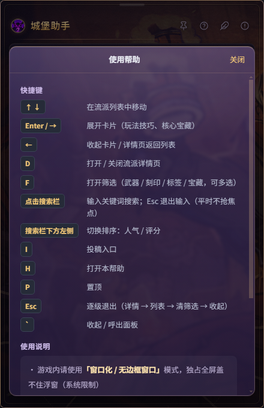

### 详情页：速记 / 完整

流派详情页的顶部右侧只显示置顶按钮。返回列表后可以继续从顶部进入帮助、投稿及设置，版本与更新内容集中在设置的「版本」区。

详情页顶部（标题下方）有一组「速记 / 完整」开关，切换的是**同一份数据的两种密度**，
默认速记；选择存在 `localStorage` 的 `lc2.detailMode.v1`，下次打开还是上次那个。

| 区块 | 速记 | 完整 |
| --- | --- | --- |
| 武器刻印 | 图标 + 刻印名 + 武器类型 | 追加刻印基础效果与图鉴描述 |
| 共鸣 | 等价的（3 档共鸣的文案本身就是选择内容） | 同左 |
| 灵魂石 | 44px 图标 + 名字 + 已选等级，窄窗口单列、560px 起两列 | 追加槽位和等级效果摘要，可展开查看图鉴的各等级效果 |
| 分配方案 | 阶段标签 + 槽位组合 | 同左 |
| 武器 / 衣服 | 装备同类同名时合到一行。武器类型缺失时由对应图鉴补齐，过渡和毕业用靠右的圆角标签区分 | 在对应装备下显示属性、说明和获取方式 |
| 宝藏 | 分档标题 + 图标名条 | 每件用独立卡片显示名称、稀有度及分段效果正文 |
| 诅咒宝藏 | 名字 + 拿不拿 / 净化不净化 | 追加诅咒代价 |
| 炼金 / 猎人道具 | 只列名字 | 追加效果 |
| 梦魇加点 | 44px 图标，名称与效果上下成组，点数独立靠右并垂直居中 | 同左（这行信息本身就是结论） |

开关本身刻意做得轻：右下角两枚小字，选中项只加金色下划线，没有胶囊底色、没有说明文字
（说明挂在 `title` 上）。`--d-*` 那套颜色里最亮的是物品名，所以开关必须比它弱一档。

详情物品图标以 44px 为基准，图像占底座的 86%，使用深色品类底座衬托图像；武器刻印为 52px，页头为 64px，共鸣图标为 44px。物品名称与标签成组，完整模式的效果说明对齐文字列。宝藏速记标签随图标增大，按可用宽度换行。

数据来源优先图鉴：投稿里只存了 `resonance.code` 时，按 `INSC[insc].effectGroups.groups`
反查出每档的 `level`，才能画出 Lv1/Lv2/Lv3 的共鸣图标。灵魂石有指定等级时显示对应效果，未指定时用图鉴中的实际数值概括范围，固定部分仍按原文显示。变化不适合概括时先显示已知等级的示例。只有一档的精粹直接写效果。

各等级效果表默认收起，浏览时优先显示摘要。需要逐级数值时可点开「各等级效果」。完整模式提高正文的字号与对比度。

#### 详情页的文字层级

详情页所有文案走 `#detail` 上的一组变量，不再各写各的颜色：

| 变量 | 色值 | 用在哪 |
| --- | --- | --- |
| `--d-name` | `#F6E9F7` | 物品名 / 刻印名 / 诅咒名 |
| `--d-note` | `#E5D6EC` | 说明正文第一条 |
| `--d-note-dim` | `#D0BCDE` | 第二条起的机制补充、`Lv.N` 档位标记 |
| `--d-meta` | `#BCA8CE` | 槽位、等级区间、序号、计数、阶段标签和来源 |
| `--d-num` | `#FFD98A`，600 字重 | 数值 / 等级 / 点数（**只有数字用金色**） |
| `--d-curse` | `#F0B5D0` | 诅咒行、负面效果 |

三条规则：

1. **金色只留给数值。** 阶段标签（`第一阶段`）、分组标题、槽位名这类"结构名"一律走 `--d-meta`，
   不然满页金色等于没有重点 —— 这正是改造前"全部近白色、看不出哪句是收益"的另一面。
2. **一行一条。** 效果文案由 `effBlock()` 按换行 + `诅咒 -` 前向断言切分：
   第一条用 `--d-note`，第二条起加 `border-left` 并压暗，诅咒行单独变粉。
   数值由 `accentText()` 挑出来包 `<i class="num">`；`Lv.N` 先单独匹配成 `.lvmark`（压暗），
   否则 `Lv.1` 的 1 会和后面 `3米` 的 3 粘成一个数。
3. **品类用色不抢文字。** 品类和稀有度标签通过 `rtag()` 生成，分组标题的色条跟随品类。
   武器用珊瑚色 `#E3A08F`，衣服用蓝色 `#93B7EE`，炼金与猎人道具用绿色 `#7CC4A0`，诅咒用粉色 `#D995BA`。
   宝藏分档再细一层：混沌紫 `#B892FF`、合成金 `#E0B44A`、必选绿 `#7FC79B`、推荐蓝 `#7FA8E8`、备选灰 `#8A90A2`。

### 打分悬停预览

列表卡片的评分条支持半颗星选择，左半颗和右半颗分别是两个档位。半颗星对应 1 分，整颗星对应 2 分，满分为 10 分。右侧实时显示当前预览或选中的分数。

鼠标移开星区后恢复已选分数；未选择时显示「未选择」。点击后保留评分条，可继续调整；再次点击打分图标或按 Esc 收起。评分选择沿用本次会话中的 `state.myVote`，单位为星数，兼容原有整星值。每个档位使用原生单选框，获得键盘焦点后可用方向键切换。

领域函数 `ratingSelection()` 统一计算星数、10 分制分数和五颗星的填充状态。表现层通过 `.is-half/.is-full` 显示半星与整星，悬停只更新预览，单选框变更时更新已选状态。


### 面板拖拽的边界策略

和 uTools 一样，**允许把面板拖出屏幕边界**（部分露出甚至大部分出界），不再强制夹在
工作区内；多显示器、负坐标也能拖过去。

但恢复位置有保护：再次呼出面板时，如果上次的位置**完全不可见**（在所有显示器里
可见面积都不足 48px），会自动夹回最近的显示器，避免窗口"消失"。

> 早先版本在 `movePanelTo()` 里对坐标做了 `clamp(workArea)`，所以拖到边缘就被挡住——
> 这不是窗口优先级问题，是业务代码自己限制的。

### 用户印象 / 评价

列表卡片右侧第三个图标（对话气泡）用来给流派写一句**简短印象**：

- 点击打开输入弹层，最多 120 字，`Ctrl+Enter` 保存、`Esc` 取消
- **可反复修改**：每个流派一条记录，再次点击图标打开「修改我的印象」直接改
- 存储按 buildId **覆盖更新**（不做增量历史）；清空内容保存即删除该条
- 已写过时图标变金色
- 数据存在本地：`<userData>/notes.json`（Electron 用户数据目录），按 buildId 索引
- 仅本机保存，不上传；后续规划把这些文本提交到服务端，用 AI 做标签分拣 / 推荐


## 数据存储

### 客户端（拉取到的数据存哪）

| 内容 | 位置 |
|---|---|
| 数据缓存（从 GitHub / 自定义地址拉取的最新数据） | `<userData>/data-cache/builds.json` |
| 缓存元信息 | 同目录，文件内记录 `__hash` / `__version`，用 hash 判断是否需要重新下载 |
| 仓库种子数据（随包分发） | `data/*.json`（打包后是 `resources/data/`） |

- Windows 开发环境 `<userData>` = `%APPDATA%\Electron`；打包后是应用自己的 userData 目录
- `LC2_CACHE_DIR`：把缓存改到自定义目录（测试 / 多实例）
- `LC2_DATA_URL`：覆盖数据源地址（自建服务 / 镜像 / 本地静态目录），默认 GitHub raw
- 数据读取链路：`source.loadBuilds()`（github → 缓存 → 本地种子）→ `data.js` → IPC → 渲染层

### 当前数据状态（准备阶段）

流派数据已**全部清空**，客户端显示「流派数据还在路上」空状态，等待真实数据接入：


- `data/builds.json`：`builds: []`（保留版本字段结构）
- 渲染层内置示例流派已移除（`catalog.js` 的 `BUILDS = []`）
- 武器 / 刻印 / 流派标签目录**保留**：这是筛选和图标的参考目录，不是流派内容
- 一但 `data/builds.json`（或数据包）有数据，界面自动恢复列表，无需改代码

### 面板描边

Windows 11 由 DWM 在系统圆角的最外沿绘制一条暖金线（`#AB7E58`）。渲染层取消内缩金框及外圈暗线，底图铺到窗口边界。面板保持 `border-radius:0`，外轮廓统一交给系统处理。

主进程通过现有面板状态下发边框模式和圆角半径。DWM 不可用时使用 `setShape`，CSS 外沿金线与实际裁剪半径保持一致。滚动区继续保留 14px 底部空间。


### 圆角毛边（Win11 DWM 边框）

面板走 Win11 DWM 系统圆角，但系统默认会给窗口画一条浅色细边框，
在深色面板的圆角处看起来像白/灰毛边。

原生 helper 在设置圆角时同时把 `DWMWA_BORDER_COLOR` 设为暖金色 `#AB7E58`，由系统绘制连续的圆角边框。使用原生边框时关闭 CSS 边框，避免叠加。

### 截图兼容（系统截图 / 微信截图）

系统截图（`Win + Shift + S`）和微信截图（`Alt + A`）的框选层是普通 topmost 窗口。
如果面板用 `screen-saver` 级置顶，框选层会被面板压住，表现为**只能在面板外面起手框选**。

因此：

- 面板 / 气泡的置顶级别统一用 **`floating`**（仍是 topmost，能盖住游戏窗口）
- **不做每秒重新抢顶层的轮询**（否则截图工具刚激活就被抢回上面）
- 不要在 `panel.js` / `bubble-window.js` 里改回 `screen-saver` 或加周期性 `setAlwaysOnTop`

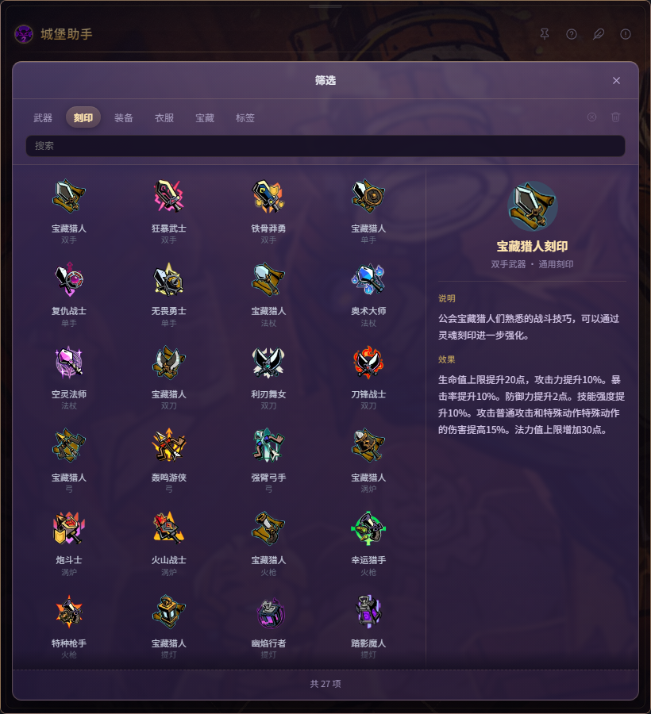

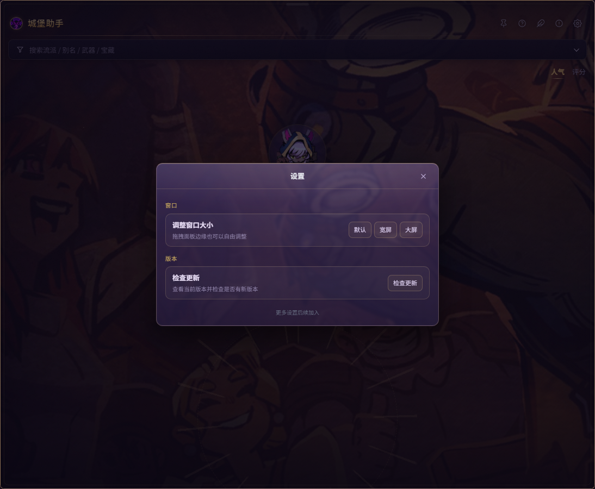
