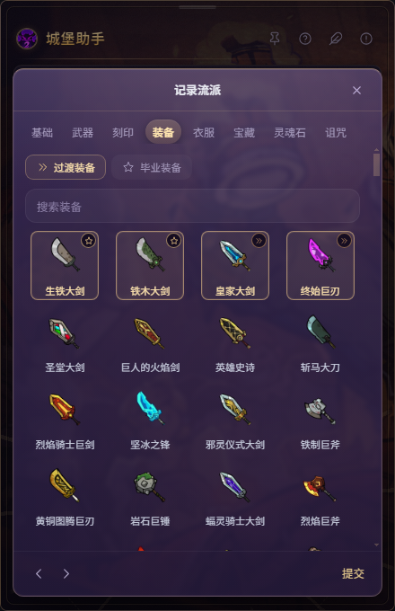
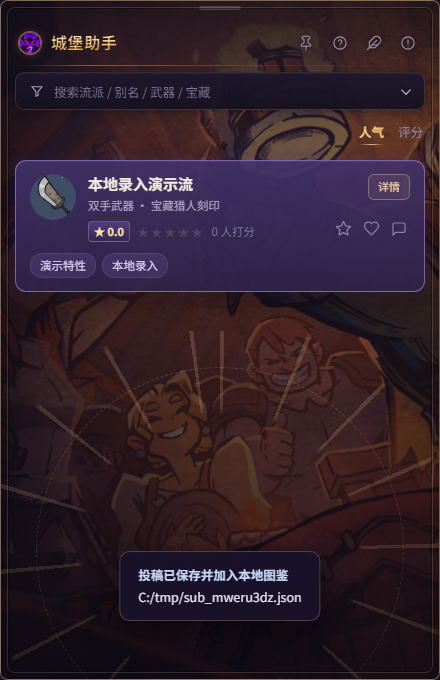

# 投稿与本地录入

> 状态：本地录入已跑通（v1）；在线投稿后台后续再做。
> 关联：[数据填写指南](./数据填写指南.md)、[流派数据调研](./流派数据调研.md)、[数据说明](./数据说明.md)。

---

## 一、现在怎么用

1. 面板右上角点 **投稿**（或按 `I`）
2. 在 **图鉴里点选**武器类型、刻印、装备、衣服、宝藏、灵魂石、诅咒宝藏（不用手打名字）
3. 填基本信息：流派名、作者、游戏版本、标签、一句话技巧；武器类型和主刻印也直接从图鉴点选
4. 顶部页签切换 8 个页面：基础 / 武器 / 刻印 / 装备 / 衣服 / 宝藏 / 灵魂石 / 诅咒
5. 点 **生成投稿**
6. 草稿保存到本机，并**立即出现在列表里**，无需重启

保存成功后列表直接显示：

---

## 二、数据存在哪

| 内容 | 位置 | 说明 |
|---|---|---|
| 投稿草稿 | `%APPDATA%/城堡助手/submissions/sub-<时间戳>.json` | 每提交一条一个文件 |
| 静态图鉴 | 仓库 `data/*.json` | 武器/装备/衣服/刻印/宝藏/灵魂石/诅咒宝藏 |
| 发布数据 | 仓库 `data/builds.json` | 后续由维护者审核后合并 |

主进程启动时会读取草稿目录，和 `data/builds.json` 合并后一起返回给渲染层；
保存后渲染层会重新拉取一次数据，所以录入后立刻能看到。

---

## 三、编辑器覆盖的图鉴

| 选择项 | 数据量 | 说明 |
|---|---|---|
| 武器（类型） | 9 | 单选，决定流派 `wt` |
| 刻印 | 27 | 单选，决定 `insc` |
| 装备（具体武器） | 353 | 顶部两个槽位：**过渡装备 / 毕业装备**，均支持多选；毕业→`weaponChoices`，过渡→`transition`，第一件毕业装作为 `gear.weapon` |
| 衣服 | 120 | 单选，轻甲/布甲/重甲 |
| 宝藏 | 397 | 点选后按顺序追加，可上移/下移/移除 |
| 灵魂石 | 146（可选 133） | 13 条 `unavailable` 不展示；逐级效果已接入，悬停可见 |
| 诅咒宝藏 | 27（可选 25） | 2 条已移除不展示；净化/不净化可点选切换 |
| 刻印 | 27 | 点选图鉴 |
| 标签 | 手填 | 建议使用现有标签词表 |

当前限制：

- 宝藏稀有度暂用 `普通` 占位，等把 wiki 深度数据接进宝藏目录后再自动带出
- 灵魂石效果 `eff` 暂为空（wiki 效果文本尚未批量抓），入库后可后补
- 流派 id 自动生成 `sub_<时间戳>`；正式合并时由维护者改成可读 id
- 没有登录/审核；本地草稿仅本机可见

---

## 四、后续后台系统的拆分点

本地草稿流程把数据形状跑通后，接后台只需要替换三处：

1. **存储**：`submission-store.js` 从本地目录换成 API/数据库
2. **提交**：`lc2:submitBuild` 从写文件换成 POST `/submissions`
3. **审核**：草稿状态从「立即展示」改成 `pending → published`

数据仍然沿用 `apps/shared/schema/build.schema.json`，不重做模型。
